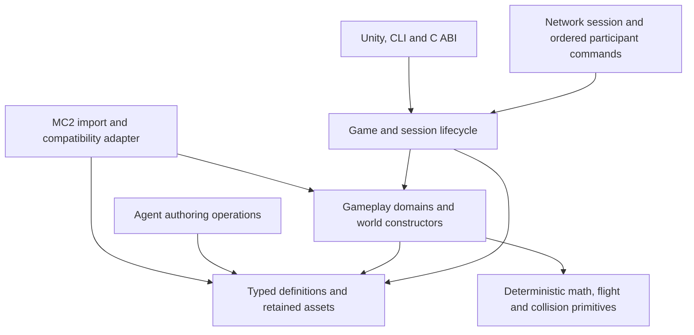

# Flying-carpet engine and MC2 source map

MC2 is the first complete game delivered by this engine. Finish its complete
single-player game first; deliver Rust-to-Rust multiplayer separately. Build the
engine so agents can readily change assets, maps, items, rules and behavior.
Content belongs in clear typed definitions; behavior belongs in focused modules
with owned state and narrow interfaces. MC2 is the first game using those
components. Agents may edit code or content directly. An external editing API
for every constant, a mod editor and a scripting runtime are not required.

This map is for implementation workers locating the real owner and consumer of
a feature. Beads hold deliverables and dependencies; this file holds source and
architecture navigation. Update a row when its implementation moves. It is not
a second progress tracker or proof that the mapped behavior already works.

Reference: `upstream/magic-carpet-2-hd`, commit
`6806c7204d17220ecc0430759f784aea8ee2ddb2`. Entries locate implementation
owners; they do not certify complete function coverage or a complete playthrough.

## Runtime ownership

Paths below are under `research/private/remc2-sim-rs/crates/` unless stated
otherwise. These are responsibility boundaries, not a demand for a crate per row.
Established focused modules should be extended directly.

Arrows mean depends on. The MC2 adapter translates raw records, selector tables,
asset banks and default policies. Domains do not import that adapter to obtain
arithmetic. A source-order orchestrator composes domain operations; transports
and presentation never become another simulation.

| Owner | Current code / change boundary | Responsibility and delivery |
|---|---|---|
| Typed content | `sim-definition/src/{level_definition,operation,catalog,package,transaction,presentation_asset,audio_asset}.rs` | Immutable game/class/property/rule/asset definitions, validation and publication. Domain registrations compose a catalog; advertised operations need real consumers. `mc-hkm` |
| Typed session contract | `sim-session/src/lib.rs` | Guarded instance, generation, participant and actor-lifetime identities; commands, bounded observations and events. Split by domain as it grows. `mc-b9s`, `mc-bc0` |
| Deterministic primitives and flight | `sim-core/src/lib.rs`, `sim-input`, `sim-collision` | Integer widths, wrapping arithmetic, flight and collision, with participant-owned state. Move source event tags/default bindings to the adapter. `mc-1pb.17`, `mc-1pb.18`, `mc-bc0` |
| World and arena | `sim-core/src/campaign/{state,source_arena}.rs`, `native_world.rs` | One authoritative composition; allocation/incarnation and lifetime ordering. Domain state moves with its behavior, without a second mutable mirror. `mc-b9s.3`, `mc-b9s.4` |
| MC2 adapter and schedule | `campaign/{spec,dispatch,schedule,source_facts,mc2_level_definition,simulation}.rs`, decoding in `native_world.rs` | `Mc2Simulation` runs every campaign mission; `CampaignSession::simulation()` exposes its single authority. Import source data, bind typed defaults and execute exact source phase/order. Retain source payload for fidelity; public IDs stay semantic. `mc-bhq.6`, `mc-6qf` and family beads |
| Creature families | `native_world/creatures/{bee.rs,bee/,creature_22.rs,creature_22/,creature_24.rs,creature_24/,goat.rs,goat/,settlements.rs,worm/}`, `native_world/level2_class5/`, remaining bodies in `level1_mission.rs` and `campaign/simulation.rs` | Family state, constructor/descendants, movement, combat/death, cleanup and live property/asset/observation bindings. Bee state and callbacks live in `creatures::bee`; `bee/mc2.rs` binds the shared arena, frozen memberships and StageVars. Model22 paired roots/parts and model24 Cave movement/contact use family kernels and StageVar logic with `mc2.rs` adapters over live `SourceArena.entities`. Settlement population state and Builder/Trader decisions live in `creatures::settlements`; `level2_class5/trader.rs` adapts the authored arena carrier. `mc-1pb`, Spider `mc-bhq.3` |
| Spells and players | `spell_activation.rs`, `spells/castle.rs`, `native_world/{level2_sessions,level2_nyphur}.rs`, shared spell bodies/carriers | Participant inventory/tiers/costs and each real spell's complete product lifetime. Castle flight guidance, particle-derived collision shape and terrain contact live in `spells/castle.rs`; the MC2 adapter supplies the current source target and retained particle binding. `mc-k5k`, Meteor `mc-bhq.4`, `mc-b9s.2` |
| Shared actor combat | Existing damage/death transitions in `level1_mission.rs` and `native_world/level2_dynamic_economy.rs`, extracted into `combat::actors` | Producer-specific damage mailboxes, linked death, kill credit, collectible mana and reclaim, consumed by real families. `mc-1pb.24`; ordinary StealMana/Duel casts remain `mc-k5k.2`. |
| Economy | `house.rs`, `villager.rs`, `native_world/creatures/settlements.rs`, `native_world/level2_dynamic_economy.rs`, existing economy carriers | Castles, mana, balloons and settlements; ownership/transfer/reclaim. House and imported Villager behavior retain their focused owners; settlement population callbacks borrow narrow source, population, RNG and feedback contexts. Remove unrelated state from the economy carrier as its owner is extracted. `mc-bhq.10`, `mc-1pb.16` |
| Terrain and world systems | `legacy_terrain.rs`, `native_world/{terrain_strip,ballistic_scenery,countdown_switch}.rs`, `campaign/objectives.rs` | Separate terrain/cave, scenery, fields/effects, items, switches and objective owners. `mc-bhq`, `mc-6qf` |
| Runtime and persistence | `sim-core/src/game_runtime.rs`, `game_runtime/campaign_menu.rs`, `campaign/backend.rs` | Game/mission/menu lifecycle, with separate content resolver, definition binding, persistence and projections. `mc-paj`, `mc-zdo.3`, `mc-zdo.4`, `mc-hkm.1` |
| Presentation descriptors | `terrain_frame.rs`, `campaign/sprite_render.rs`, existing `sim-*-tmap`/raster crates and live projections; Unity `CampaignSpriteCompositor.cs` | Draw order, animation/direction and draw-consumed clocks; read authoritative state and use retained assets. Source sprite pixel operations and fog come from Rust; the indexed GPU compositor consumes live cell/map-chain order and retained TABLES bytes. `mc-oi6`, `mc-hkm.3` |
| Network session | Planned focused transport and multiplayer domain modules | Admission, ordered participant commands, roster/turn authority, cancellation and typed peer events. Reuse the same simulation; MC2 wire formats remain optional adapters. `mc-bc0` |
| Native boundary | `sim-capi/src/native_v2/` | Handle registry and bounded codecs into the same authority. `mc-b9s`, `mc-hkm.1`, `mc-bc0` |
| Human client | `../remc2-unity-native/Assets/Scripts/` | `MagicCarpetRuntime` becomes composition/lifecycle wiring. Existing transports and `CampaignPresentationSurface` remain canonical; input, frontend, world, HUD and audio have instance-owned components. No gameplay or global current-game state in presenters. |

Current coupling is real: `campaign/simulation.rs` is included as a child of
`native_world` and imports `super::*`; moving a file has not separated its state
ownership. `SourceArena` also holds an economy carrier with several unrelated
responsibilities. `campaign/backend.rs` mixes package resolution, replay and
projection, while `MagicCarpetRuntime.cs` combines several client responsibilities.
Raw line counts include substantial tests and are not a sound production-size
metric.

Possession's holder timing is owned by `spell_activation/possession.rs`; its
typed defaults are in `sim-definition/src/level_definition/possession.rs`.
The MC2 projectile/contact and death-marker adapters remain in
`native_world/level2_dynamic_economy.rs`, with current target reads and physical
relation transfers in `native_world/source_target.rs`.

Fireball's holder timing is owned by `spell_activation/fireball.rs`, with typed
defaults in `sim-definition/src/level_definition/fireball.rs`. Its MC2 flight,
collision, capture and damage adapters use `native_world/level2_dynamic_economy.rs`
and `source_target.rs`. Shared impact construction and following-pass lifetime
remain in `native_world/effects.rs` and `world/effects.rs`; FireSpheres use the
same canonical source-slot allocator as their ordinary descendants.

Morph's ordered holder transition and rival flicker are in
`spell_activation/morph.rs`; its typed creature choices are in
`sim-definition/src/level_definition/morph.rs`. Controlled bodies are owned by
`native_world/creatures/morph.rs` and the canonical Bee owner. Wyvern and
Cymmerian construction shares the ordinary/Army constructors and counters.
The simulation adapter reads current A4 colour, holder and parent records;
generation-bound body relationships own expiry and following-pass reclaim.

Each playable feature moves its relevant canonical state and behavior to its
owner, then leaves thin registrations in shared roots. A module with unrestricted
whole-session access or only methods on the same god object does not satisfy this
boundary. Do not block the port on a wholesale rewrite or copy a second runtime.

An agent should find an aspect's definition, constructor, behavior owner and
runtime consumers from this map and its feature bead. Changes belong in those
owners and their necessary typed interfaces, without editing unrelated families
or implementing gameplay in a client. MC2 formats, numeric selectors and default
bindings stay in the compatibility adapter. Algorithms and constants may remain
ordinary code in their domain module; use editable data where it represents
content usefully. This is an engine architecture, not a requirement to build a
separate mod-authoring product.

## Source-order invariants

Keep producer/constructor, dispatch identity, handler, common epilogue, next-pass
reclaim, authoritative carrier and downstream consumer together in each bead.
In particular, preserve:

- Ascending live-slot scans, later-slot same-pass births, earlier-slot deferral
  and occupant re-resolution after replacement.
- Source entity addresses survive reclamation: `sub_57F20` clears class but
  retains fields and list links; `NewEvent` overwrites the record. Frozen
  class lists follow the current `next_0` links and current record fields,
  including hidden or reclaimed rows, until a constructor replaces them.
- RNG prepasses, frozen memberships, fixed-width arithmetic and source timing.
- Multipart ownership, root/child lifetimes and actual allocation incarnation.
- Draw-consumed selector clocks and actor/definition/session resource lifetimes.
- Immutable definitions: publish a candidate, explicitly reopen to adopt it, and
  retain exact content identity in saves/replay. Do not change a live generation
  beneath its consumers.

## Delivery paths

`mc-zdo.5` remains the first opening milestone: normal startup and continuous
Levels 1–4. `mc-xa7.1` assembles all 25 ordinary and five secret missions, their
interlevels and the actual ending. Shared mechanisms are ported once; mission
content selects them. Independent family workers can proceed in parallel while
shared scheduler/ABI/client integration has one writer at a time.

`mc-bc0` is complete Rust-to-Rust multiplayer. Final multiplayer assembly follows
single-player release; its foundation tasks depend on actual required capabilities.
Legacy interoperability is a separate deferred outcome. A TCP implementation in
remc2 is source evidence, not evidence that its experimental multiplayer path was
played successfully in this inspection.

`mc-hkm` and `mc-b9s` are shared engine outcomes. The `mc-b9s` observation/control
contracts help agents inspect and exercise the real game. The `mc-hkm` workspace,
variant-authoring and standalone-game tools remain later capabilities; they do
not block the complete MC2 single-player release. Domain ownership and typed
content still belong to each ordinary gameplay feature, not to a later rewrite.
The existing authoring API is useful but incomplete: `BindAsset` selects retained
content, operations do not yet create/remove placements or author terrain, and
current runnable packages still depend on MC2 adapters. The new beads supply real
operations and real play to close those gaps.

Concrete implementation splits retain their full integration outcomes:
`mc-5r5.4` preferences and `mc-5r5.5` installed language/glyph bindings feed
`mc-5r5.2`; `mc-k5k.8`–`.12` deliver Morph, Castle, Fireball, Possession and
player-status tiers before `mc-k5k.7` integrates their acquisition/rewards.
`mc-hkm.7.1` supplies an authored flyable world and `.7.2` its real combat/objective
completion; the original standalone-game outcome remains `mc-hkm.7`.
Optional human-report tooling `mc-xks` is separate from full-game completion.

Secret delivery has an explicit producer/consumer order: `mc-6qf.3` admits the
real source31 witness after its known content owners land; `mc-6qf.6` supplies
ordinary portal/return results; `mc-paj.2` consumes them to load and return from
all five secret worlds; `mc-6qf.4` retains complete entry-and-return integration.
This keeps the original outcome open without making its producer wait for its
own downstream loading consumer.

Existing authoring operations use discover → edit → validate → publish → reopen
→ play/observe through the same authority as a human client. Direct repository
code/content edits are also a normal engine workflow. The initial CLI owns its
runtime; attachment to another running Unity process is not implied. Compiled
behavior modules plus supported typed configuration are the present extension
mechanism; arbitrary script execution is not an implemented feature. An AI player
is optional.

## remc2 source and function families

All source paths in this table are relative to
`upstream/magic-carpet-2-hd/remc2/`. The table covers the union of all **74 C/C++
translation units quoted in its CMakeLists.txt**, including conditional units
and the linked findfirst library. That is build-roster coverage, not a claim
that every function/branch has been ported or inspected. The family beads own
the detailed producer-to-consumer trace and runtime result.

| Source units | Function families / responsibility | Port owner or outcome |
|---|---|---|
| `remc2.cpp` `sub_main.cpp` `engine/CommandLineParser.cpp` | `remc2.cpp::main` `sub_main.cpp::sub_main` `engine/EventsFunctions.cpp::Initialize / sub_46830_main_loop` Live bootstrap/session lifecycle; debug command modes separate | `mc-5r5`, `mc-paj`, `mc-zdo.1`, `mc-zdo.2` |
| `engine/Events.cpp` `engine/EventsFunctions.cpp` `engine/EventDispatcher.cpp` `engine/LevelStructs.cpp` | `Events.cpp::ApplyEvents` `EventsFunctions.cpp::UpdateEntities_57730 / PlayerEvents_51BB0 / family constructors and updates` `EventDispatcher.h::EventDispatcher` Live gameplay; source monolith split by actual family responsibility | `mc-1pb`, `mc-bhq`, `mc-k5k`, `mc-6qf`, `mc-1pb.18`, `mc-bc0` |
| `engine/Level.cpp` `engine/LevelInit.cpp` `engine/ConvertMapInfo.cpp` | `EventsFunctions.cpp::LevelDecompress_533B0 / LevelInitGame_56A30` `LevelInit.cpp::LevelInit_56C00 / SetLevelId_53590` `ConvertMapInfo.cpp::DecompressLevel_2FECE` `Level.cpp::SaveLevel_55080 / LoadLevel_555D0` Live content import, initialization and persistence; optional sprite/font patch branches separately classified | `mc-bhq.6`, `mc-6qf.3`, `mc-bc0.15`, `mc-zdo.3` |
| `engine/Terrain.cpp` `engine/BasicTerrain.cpp` `engine/Unk_D47E0.cpp` `engine/Unk_D4A30.cpp` `utilities/Maths.cpp` | `Terrain.cpp::terrain generation/height/material/cave algorithms` `Unk_D47E0.cpp::unk_D47E0` `Unk_D4A30.cpp::unk_D4A30` `Maths.cpp::integer angle/trig helpers` Live deterministic terrain and arithmetic lookup data | `mc-bhq.2`, `mc-bhq.5`, `mc-bhq.8`, `mc-bhq.12` |
| `engine/Player.cpp` `engine/PlayerInput.cpp` | `Player.cpp::MoveEntity_57FA0` `PlayerInput.cpp::MouseAndKeysEvents_17A00 / ComputeMousePlayerMovement_17060 / HandleButtonClick_191B0 / sub_1A7A0_fly_asistant / ChangeSettings_1A970` Live human input and source command consumption | `mc-5r5.2`, `mc-oi6.5`, `mc-paj.6`, `mc-1pb.18`, `mc-bc0` |
| `engine/Spells.cpp` `engine/Type_D93C0_Bldgprmbuffer.cpp` `engine/Type_D94F0_Bldgprmbuffer.cpp` | `Spells.cpp::SetDefaultSpells_5C0A0` `Type_D93C0_Bldgprmbuffer.cpp::str_D93C0_bldgprmbuffer` `Type_D94F0_Bldgprmbuffer.cpp::str_D94F0_bldgprmbuffer` `EventsFunctions.cpp::InitialiseSpells_54A50` Live owner SPELLS/BLDGPRM rules and fixed source data | `mc-k5k`, `mc-bhq.10`, `mc-6qf.2`, `mc-hkm` |
| `engine/Type_WORD_D951C.cpp` `engine/Type_D404C.cpp` `engine/UVTable_D4350.cpp` | `Type_WORD_D951C.cpp::particlesParameters_D951C[347]` `Type_D404C.cpp::str_D404C[5]` `UVTable_D4350.cpp::UV table` Live parameter/UV/visual binding data | `mc-oi6.1`, `mc-hkm`, `mc-1pb`, `mc-bhq`, `mc-k5k` |
| `engine/GameRenderOriginal.cpp` `engine/GameRenderHD.cpp` `engine/GameRenderNG.cpp` `engine/GameRenderGL.cpp` `engine/ProjectionPolygon.cpp` `engine/RenderThread.cpp` | `GameRenderOriginal.cpp::DrawTerrainAndParticles_3C080 / DrawWorld_411A0 / DrawSorcererNameAndHealthBar_2CB30` `GameRenderHD/NG/GL alternative renderer implementations` Original live visual semantics; optional alternative render backends | `mc-oi6.1`, `mc-oi6.3`, `mc-oi6.4`, `mc-oi6.7` |
| `engine/ReadAndDecompress.cpp` `engine/DatTabIndexes.cpp` `engine/TextureMaps.cpp` `utilities/DataFileIO.cpp` `utilities/DataFileRNC.cpp` | `ReadAndDecompress.cpp::sub_54660_read_and_decompress_sky_and_blocks / sub_54800_read_and_decompress_tables` `DatTabIndexes.cpp::CreateIndexes_6EB90` `TextureMaps.cpp::sub_70A60_open_tmaps / sub_70C60_decompress_tmap / sub_721C0_initTmap / ResetAnimation_72410` `DataFileIO.cpp::LoadFileArray_84250 / ReadFileAndDecompress` `DataFileRNC.cpp::Decompress` Live import, decode, animation resource lifetimes | `mc-bhq.6`, `mc-oi6.1`, `mc-oi6.2`, `mc-bc0.15` |
| `engine/Basic.cpp` `engine/GameBitmap.cpp` `engine/GameUI.cpp` `engine/Graphics.cpp` `engine/ViewPort.cpp` `engine/ScreenBuff.cpp` `engine/BasicMini.cpp` `engine/MouseOnOff.cpp` | `Basic.cpp::GetFont_6FC50 / DrawText_7FB90 / DrawCursor_8C635 / sub_6F940_sub_draw_text` `GameBitmap.cpp::DrawBitmap / DrawTransparentBitmap_2DE80 / DrawMenuGraphic` `GameUI.cpp::DrawTopStatusBar_2D710 / DrawCurrentObjectiveTextbox_30630 / DrawMinimap_63600 / DrawTextboxText_895D0` `Graphics.cpp::sub_A0D50_set_viewport` Live indexed UI/text/cursor/composition; Basic.cpp also has platform wrappers | `mc-5r5.3`, `mc-oi6.5`, `mc-oi6.6`, `mc-oi6.7`, `mc-paj.4` |
| `engine/MenusAndIntros.cpp` `engine/Type_MapScreenPortals_E17CC.cpp` `engine/Type_SecretMapScreenPortals_E2970.cpp` | `MenusAndIntros.cpp::MainMenu_76FA0 / NewGameDialog_77350 / NewGameDraw_7EAE0 / LanguageSettingDialog_779E0 / SetKeysDialog_79610 / SetJoystickDialog_79160 / PresentLevelDescription_80C30 / ShowEndCredits_833C0` `Type_MapScreenPortals_E17CC.cpp::mapScreenPortals_E17CC` `Type_SecretMapScreenPortals_E2970.cpp::secretMapScreenPortals_E2970` Live frontend plus mission/map/menu fixed tables | `mc-5r5`, `mc-paj`, `mc-zdo.4`, `mc-bc0`, `mc-oi6.10` |
| `engine/Animation.cpp` | `Animation.cpp::PlayInfoFmv / ReadFrame_75DB0 / DrawFrame_75E70 / PlayIntoSoundEvents_1B280 / ReadIntroPalettes_76260` `MenusAndIntros.cpp::Intros_76D10 / PlayInGameFmv_82670 / ShowEndCredits_833C0` Live intro/attract/CUT frame, palette, subtitle and audio sequences | `mc-5r5.1`, `mc-paj.7` |
| `engine/Sound.cpp` `engine/XmiInfo.cpp` `portability/port_sdl_sound.cpp` `portability/xmi2mid.cpp` | `Sound.cpp::LoadSounds_84300 / PlaySample_8F100 / StartMusic_8E160 / UpdateMusic_99970 / StopMusic_8E020` `XmiInfo.cpp::XMIDI duration/controller inspection` `port_sdl_sound.cpp::PlayCdTrackSegment / EndPlayingCdTrackSegment / ClearCdTrackSegment` `EventsFunctions.cpp::PresentObjective_59820 / PlayCDTrackSegmentNumber_86EB0` Live sample/music/speech semantics plus replaceable reference audio backend | `mc-oi6.8`, `mc-oi6.9`, `mc-oi6.10`, `mc-5r5.1` |
| `engine/Network.cpp` `portability/port_net.cpp` | `Network.cpp::connection/session/input exchange families` `port_net.cpp::transport implementation` `MenusAndIntros.cpp::MultiplayerMenu_7DE80` Live multiplayer behavior plus compatibility transport | `mc-bc0`, `mc-bc0.15` |
| `engine/read_config.cpp` `portability/Config.cpp` `portability/fcaseopen.cpp` `portability/port_filesystem.cpp` `portability/port_outputs.cpp` `portability/port_sdl_joystick.cpp` `portability/port_sdl_vga_mouse.cpp` `portability/port_show_perifery.cpp` `portability/port_time.cpp` `engine/PrintMessages.cpp` `stdafx.cpp` | `read_config.cpp::SetConfig` `Config.cpp::GetSettings / SaveControlsToDoc` `port_sdl_joystick.cpp::host joystick adapter` `port_sdl_vga_mouse.cpp::window/input adapter` `port_time.cpp::host timing` Reference platform shims and remc2 host preferences | `mc-5r5.2`, `mc-zdo.1`, `mc-zdo.2` |
| `engine/Compare.cpp` `engine/CompareMaps.cpp` `engine/engine_support.cpp` `engine/engine_support_converts.cpp` `portability/InputRecorder.cpp` `utilities/RendererTests.cpp` `utilities/StateMonitor.cpp` `utilities/BitmapIO.cpp` | `Compare.cpp / CompareMaps.cpp::reference comparison helpers` `engine_support.cpp::support_begin / support_end and regression state` `engine_support_converts.cpp::legacy state conversion` `InputRecorder.cpp::record/replay` `RendererTests.cpp / StateMonitor.cpp::reference verification` `BitmapIO.cpp::bitmap import/export` Debug/regression and developer utilities, with mixed support lifecycle helpers | `mc-xks.1`, `mc-xks.2` |
| `lib/stb_impl.cpp` `../findfirst/findfirst.c` `../findfirst/spec.c` | `CMakeLists.txt:271 target_link_libraries` `lib/stb_impl.cpp` `findfirst library` Third-party and compatibility libraries | Existing dependency/host adapters; no gameplay port bead |

Inside the large dispatch units, the production coverage is:

| Source family | Enabled scope and real owner |
|---|---|
| Class 5 creatures | Models 0,1,2,3,4,9,10,12,13,14,15,16,17,18,19,20,21,22,23,24,25,26,27,28; enabled descendant action232; allocated children233/234 have disabled callback entries. `mc-1pb` and Spider `mc-bhq.3` cover ordinary construction through combat/death and reclaim. Disabled 5/6/7/8/11 remain disabled. Unverified friendly names are not invented. |
| Class 3 players/wizards | Flight, human input, rival AI, spell holders, rewards and death/revival. `mc-1pb.17`, `mc-1pb.18`, `mc-6qf.2`, `mc-bhq.10`; participant integration in `mc-bc0`. |
| Class 15 spells / class 9 projectiles | All 26 spell families 0–25; holder/pickup actions 0–78; projectile constructors 0–30/actions 0–31 as actual descendants. `mc-k5k`, Meteor `mc-bhq.4`, and creature attack owners. Source map gates and no-ops remain deliberate. |
| Class 2 scenery | Constructor range 0–8/actions 0–21; real nonempty paths belong to `mc-bhq.1`, `.5`, `.13` and their immediate producer families. Cave-null barrel constructors stay null. |
| Class 10 effects/world | Constructor range 0–91/actions 0–98, including terrain 61–64. `mc-bhq.2`, `.5`, `.8`, `.9`, `.10`, `.12`; immediate spell/creature descendants stay with their producer. No invented behavior for empty entries. |
| Class 14 controllers/items | Constructors 0–5/actions 0–10. `mc-bhq.11`, `mc-6qf.1`, `.4` and source effect owners; retain their complete lifetime. |
| Class 11 activation / objective language | Selectors 0–44, authored stageTag/DisId/group order, stage forms 0–9 and `sub_58DA0` bindings. `mc-6qf.1`, `mc-bhq.7`; forms4/6 exist in source but are absent from the decoded 40 shipped records. |
| Inactive/metadata classes | Class 0 sentinel; class 1 reset/constructors; empty classes 4/6/7/8/12; class 13 metadata with zero executable callback addresses. Import/reset adapters preserve these; display labels do not establish missing gameplay. |

The class5 offset6 actions 6,22,30,38,78,126,134,142,150,158,166,174,
182,190,206,214,222,230 have enabled table addresses but no dispatch case.
Their shipped descriptors lack the bit8 production gate, so ordinary actor
production cannot reach them. They are unsupported source routes, not empty
callbacks. Only Goat/Villager/Trader/Builder descriptors enable that branch,
and their handlers exist. Action232 is enabled; allocated233/234 are disabled.
Frozen family memberships and the subsequent live-slot callback scan are
separate: a newly allocated higher slot can still execute in the same pass.

Spell IDs, projectile models and scheduled actions are distinct. In particular,
Meteor9 launches projectile9/3 then effect10/17; CaveIn25 uses9/30 then10/89.
Effect ownership follows behavior: Tremor10/71 belongs to terrain, Army10/72
to summoning, GravityWell10/67 to fields, Alliance10/74 to its spell, and
Possession10/12 to `mc-k5k.11`. Checkpoint10/59 is a smoke cluster; jar10/91 repeatedly produces mana and
spell experience. Their actual source consumers belong to items. Terrain27
belongs to `mc-bhq.8`; slowdown65 and immobilization66 belong to `mc-bhq.12`.
Do not infer a new behavior from a numeric range containing disabled entries.

State/identity and asset-selector headers follow these same owners:
`Event.h`, `EventType.h`, `GameState.h`, `global_types.h`, `LevelStructs.h`,
`TypeConfigDat.h`, `GameBitmapIndexes.h`, `LangTextIndexes.h`,
`SoundInGameIndexes.h`, `WavIndexes.h`, `Type_DB080_CdTrack.h`,
`Type_Animations.h`, `MapColourIndexs.h` and `GameUiConstants.h`.

## Asset formats, bindings and consumers

The owner data is consumed by `remc2-level-exporter`,
`remc2-level-asset-closure` and `remc2-unity-asset-cache` under
`research/private/`, then bound into immutable definitions and the production
runtime/presenters. Assets include later births, transformation/death products,
menu/loading media and sound; an initial-level sprite inventory is insufficient.
Raw game files, decoded caches and generated products stay local and ignored.
In consumer labels below, `rust:` means a `sim-core/src/` responsibility unless
another crate is named; `unity:` means `remc2-unity-native/Assets/Scripts/`;
`cache:`, `exporter` and `closure` name the three import tools above. New owners
are delivery targets, not claims that those modules already exist.

| Source formats / banks | Typed binding and real consumer | Delivery |
|---|---|---|
| `GAME/NETHERW/CLEVELS/LEVELS.DAT + LEVELS.TAB, falling back to CD_Files/LEVELS/LEVELS.DAT + LEVELS.TAB` `4000-byte offset table; selected DAT range RNC decoded into Type_CompressedLevel_2FECE` `ordinary source 0..24; secret 30..34; multiplayer 50..59` | Semantic mission/match ID, seed, environment, placements, objectives, starts and rules; numeric rows stay adapter-private. `exporter` `rust:campaign/spec.rs / source_facts.rs / game_definition/mc2_owned.rs` | `mc-bhq.6`, `mc-6qf.3`, `mc-bc0.15` |
| `DATA/BLOCK16.DAT, BLOCK32.DAT; BL16N0-0/BL32N0-0, BL16F0-0/BL32F0-0, BL16C0-0/BL32C0-0.DAT` `DATA/PALD-0/PALN-0/PALF-0/PALC-0.DAT; CLRD-0/CLRN-0/CLRC-0.DAT; TABLESD/TABLESN/TABLESC.DAT` `DATA/SKYD0-0.DAT and SKYN0-0.DAT; source cave branch has no sky read` | Typed indexed material profile with texture, RGB6 palette, colour/blend tables, resolution and sky/no-sky. `closure` `cache:build_cache.py` `rust:day_indexed_frame.rs` `unity:OwnerAssetCache.cs / CampaignPresentationSurface.cs` | `mc-oi6.2`, `mc-oi6.3`, `mc-oi6.4` |
| `GAME/NETHERW/CDATA/TMAPS0-0/1-0/2-0.DAT with DATA fallback; DATA/TMAPS*.TAB` `DATA/MSPRD0-0/MSPRN0-0/MSPRC0-0.DAT/.TAB and HSPR equivalents` `DATA/MWEBD0-0/MWEBN0-0/MWEBC0-0.DAT/.TAB and HWEB equivalents` `DATA/BUILD0-0.DAT/.TAB and POINTERS.DAT/.TAB` | Class/action visual slots, directional/animated frames, content identity, masks, scale and palette; actual family clocks remain authoritative. `cache` `rust:family tmap/raster modules` `rust:semantic game-definition adapter` `unity:SemanticPresentationAssetCache.cs / CampaignPresentationSurface.cs` | `mc-oi6.1`, `mc-oi6.5`, `mc-oi6.7`, `mc-hkm.3`, `mc-hkm.4` |
| `DATA/SPELLS.DAT` `DATA/BLDGPRM.DAT` `particlesParameters_D951C[347], str_D94F0_bldgprmbuffer[3][5], source spell maps, UV/terrain/integer tables` | Typed class/property/rule/asset defaults and validated ranges consumed by ordinary constructors; compiled behavior policy selection stays explicit. `exporter` `rust:MC2 adapter` `rust:sim-definition catalog/operations` `rust:actual family constructor/update owners` | `mc-hkm`, `mc-1pb`, `mc-k5k`, `mc-bhq`, `mc-6qf` |
| `LANGUAGE/L*.TXT and D*.TXT: 4773-byte bitmap data + 12-byte table, then 471 NUL-delimited text records at offset 4785` `DATA/FONT0.DAT/.TAB, FONT1.DAT/.TAB, HFONT3.DAT/.TAB; HSCREEN embedded frontend glyphs` `Local LANGUAGE directory contains L1.TXT and D2.TXT only` | Semantic locale/text keys and font/glyph/layout assets; source byte-glyph mapping and selectors stay adapter-private. `cache` `unity:Mc2ObjectiveText.cs / ObjectiveTextboxCompositor.cs` `rust:indexed_overlay.rs` | `mc-5r5.2`, `mc-5r5.3`, `mc-oi6.5`, `mc-oi6.6`, `mc-paj.4`, `mc-paj.7` |
| `DATA/SCREENS/HSCREEN0.DAT packed offset-addressed screens, palettes, sprites and bitmap tables` `DATA/SMATITLE.DAT/.PAL and SMATITL2.DAT/.PAL` `Source menu/button/portal/animation tables` | Screen/animation/hit-region/loading/portal assets; Rust state determines availability and results. `cache:build_campaign_menu_cache.py` `unity:OwnerCampaignMenuCache.cs / CampaignMenuPresenter.cs / CampaignTransitionPresenter.cs` `rust:game_runtime/campaign_menu.rs` | `mc-5r5.3`, `mc-paj.4`, `mc-paj.5`, `mc-zdo.4`, `mc-bc0` |
| `INTRO/INTRO.DAT, INTRO2.DAT, CUT1.DAT..CUT6.DAT` `Source sound-event/subtitle tables, frame/palette chunks and HSCREEN credit assets` | Media sequence/clip/segment plus frame-timed audio/subtitles; guarded transition and generation cleanup. `cache:media decoder` `rust:game-runtime media owner` `unity:media/transition presenter` | `mc-5r5.1`, `mc-paj.7` |
| `SOUND/SOUND.DAT bank/quality/PCM records` `Source priority, pitch/pan/loop and actor-lifetime selectors` | Semantic sample/loop asset keyed to generation and actor lifetime; bank numbers stay private. `cache:build_cache.py` `rust:family event producers / native events_audio_abi.rs` `unity:OwnerAudioPresentation.cs` | `mc-oi6.8` |
| `SOUND/MUSIC.DAT indexed XMIDI sequences` `SOUND/SAMPLE.AD, SAMPLE.OPL, BULLFROG.SBK where the selected source/adaptation actually consumes them` `Current xmi_convert.cpp and adl_render.cpp adaptation` | Semantic music bank/track/controller/loop with source envelope; synthesis backend explicit. `rust:sim-music` `cache:xmi_convert.cpp / adl_render.cpp` `unity:OwnerAudioPresentation.cs` | `mc-oi6.9`, `mc-5r5.1` |
| `speechFolder/TRACK%02d.WAV; local reference enhancedassets/sound/speech/TRACK01.wav..TRACK27.wav` `Type_DB080_CdTrack.h::CdTracks_DB080[28] with ten segment rows per entry` | Semantic speech asset and bounded segment, source time conversion, presentation phase and completion/duck identity. `cache:focused speech builder` `rust:objective/speech owner` `unity:OwnerAudioPresentation.cs` | `mc-oi6.10`, `mc-paj.4`, `mc-oi6.6`, `mc-5r5.2` |
| `CONFIG.DAT 32-byte record, signature 0xfffffff7` `SAVE/SLEV*.DAT, SMAP*.DAT, SVER*.DAT and slot metadata` `remc2 config.json host preferences` | Versioned preferences and Rust campaign/session state with definition/content identity and atomic local publication. `rust:game_runtime.rs / campaign/backend.rs` `rust:immutable workspace persistence` `unity:CampaignMenuPresenter.cs` | `mc-zdo.3`, `mc-zdo.4`, `mc-5r5.2`, `mc-hkm.1` |
| `enhancedassets graphics block128.data/bl128*.data/skyd1024.data/skyn1024.data` `PNG sprite/font overrides via Level.cpp LoadFixedFonts and sprite patch paths` `music-ogg and alternative/day/night/cave OGG tracks` `font/16x16-font.bmp, 8x8-font.bmp, UbuntuMono-B.ttf` | Explicit optional variants through existing asset contracts; original defaults remain distinct. `rust:sim-enhanced-presentation` `rust:retained semantic asset variants` `unity:SemanticPresentationAssetCache.cs` | `mc-hkm`, `mc-oi6.1` |
| `DATA/GTD2.DAT` | Day exit lookup/blend data: `Level.cpp::LoadSpr_47160` buffer -> `sub_5E8C0_endGameSeq` -> timed status renderer. This is a normal Day exit requirement. | `mc-oi6.7` |
| `SOUND/*.DIG, *.MDI, AILDRVR.LST` `DATA/DFONT*, SFONT*, GTDEF*, FTDEF*, ETEXT/FTEXT/GTEXT/ITEXT/SPTEXT/SWTEXT.DAT, extra title/logo assets` `INTRO/INTEL.DAT` | Bind source-active consumer branches; hardware drivers remain host implementation detail. File existence does not prove a live branch or completed replacement. | `mc-5r5.5`, `mc-oi6.6`, `mc-oi6.7`, `mc-oi6.8`, `mc-oi6.9` |

Mission identities are distinct domains: ordinary source 0–24 (external 1–25),
secret 30–34 and multiplayer 50–59. Reserved rows 25–29 and 35–49 are not silently
offered as playable missions. The ten multiplayer names are Thrull, Keevur,
Braak, Trapox, Hibren Zhor, Jinople, Dethrem, Canquin, Zephulum and Verune.
`mc-bc0.17` opens the first actual world, Thrull (source50, Day);
`mc-bc0.3` supplies the first synchronized turn. `mc-bc0.18` extends that same
admission path to Hibren Zhor (54, Night) and Jinople (55, Cave), while
`mc-bc0.15` completes all ten maps. Their known creature, item, effect and spell
constructors are real prerequisites. Decoding/cataloguing a map does not prove
its gameplay.

Actual final mission source24 is Night with feature byte2. Its authored
record373 is special building10/45 parameter68; destruction releases group29
and boss5/10 at record379 (`mc-1pb.3`). Ordered objectives reach (40,212) and
kill the bound boss. Switch392 releases group31: visible exit393 at (125,170) and a distinct
class11/model12 controller394 at (227,237). Controller overlap, not the visible
sprite, selects player action12 and the authoritative result consumed by
`mc-paj.7`. `mc-6qf.5` owns this real
assembly, including the boss's dynamic children and building protection tail.
This mapping comes from decoded owner data and source, not a completed playthrough.

Newly explicit source omissions are objective/briefing CD speech (`mc-oi6.10`),
the fire-Night palette/material branch (`mc-oi6.2`), selected-language glyph/cache
identity and the idle flight-assistance producer (`mc-5r5.2`). Speech has its own
segment, duck/fade and cleanup lifecycle, separate from SOUND.DAT and XMIDI.
The mission code currently selects speech-disabled behavior. Map briefing uses
segment zero from the same speech consumer, so `mc-paj.4` now depends on it.

### Shipped mission inputs

This index comes from decoding all 40 actual owner records with the pinned RNC
implementation. It is an import/assembly input for `mc-bhq.6`, `mc-6qf.3`,
`mc-bc0.15` and their gameplay owners, not a playthrough result. Source row IDs
remain adapter-private. Creature IDs below are authored class5 models; the
constructors, attacks, transformations, death products and shared spell tables
supply additional runtime descendants. Use those production chains as well as
these rows when admitting a mission. Eight wizard profiles, 1200 entity rows,
eight stage rows and eleven StageVars are retained for every mission.

| Mission / source | Environment / flag | Authored objective kinds in order | Authored creature models |
|---|---|---|---|
| 1 / 0 | Night / 0 | 5,5,7,0,7 | 1,3,4,13,19 |
| 2 / 1 | Day / 0 | 5,3,7,5,9 | 1,2,3,4,9,13,14 |
| 3 / 2 | Day / 0 | 7,7,0,5,7 | 0,1,2,3,4,9 |
| 4 / 3 | Cave / 0 | 0,7 | 0,9,19,20 |
| 5 / 4 | Day / 0 | 3,3 | 0,1,2,3,4,9 |
| 6 / 5 | Cave / 0 | 1,7,5,7 | 0,3,9,18,19,20,26 |
| 7 / 6 | Night / 0 | 8 | 0,3,9,12,13,14,19,20,22 |
| 8 / 7 | Cave / 0 | 7,5,5,7,7,9 | 0,3,9,19,20,21,26 |
| 9 / 8 | Day / 0 | 1,1,3,2,7 | 0,2,3,9,17,20,21,22,26 |
| 10 / 9 | Night / 0 | 9,7,5,0 | 0,3,9,17,21,25,26 |
| 11 / 10 | Night / 0 | 5,9,7,5 | 0,9,20,21,28 |
| 12 / 11 | Cave / 0 | 5,5 | 0,4,18,19,20,21,26 |
| 13 / 12 | Day / 0 | 3,3,3,3 | 0,1,2,3,4,17,20,21,25,26 |
| 14 / 13 | Night / 0 | 0,1,7,7 | 0,1,3,13,18,19,20,21,22,23,25,26,28 |
| 15 / 14 | Cave / 0 | 7,7 | 0,3,9,17,18,19,20,21,22,24,25,26 |
| 16 / 15 | Cave / 0 | 2,1,1,9,7 | 3,9,18,19,20,21,22,24,25,26 |
| 17 / 16 | Day / 0 | 8 | 0,17,18,20,21,22,23,25,26,28 |
| 18 / 17 | Night / 0 | 0,1,0,3 | 9,16,17,18,19,20,23,25,26,28 |
| 19 / 18 | Night / 0 | 8 | 16,17,18,19,20,21,22,23,25,26,28 |
| 20 / 19 | Day / 0 | 7,1 | 4,13,16,26,27,28 |
| 21 / 20 | Cave / 0 | 7,7 | 18,20,21,24,25,26,28 |
| 22 / 21 | Night / 0 | 1,0 | 1,14,19,20,21,22,23,25,27,28 |
| 23 / 22 | Day / 4 | 2,9,2,2,9,8,0 | 2,4,9,16,18,20,21,22,23,25,26,27 |
| 24 / 23 | Cave / 0 | 5,7,5,9,7 | 0,16,18,24,25,26 |
| 25 / 24 | Night / 2 | 5,1 | 3,9,10,16,17,18,19,20,21,23,25,26,27,28 |
| Secret 1 / 30 | Cave / 0 | 0 | 0,3,4,9,19,20 |
| Secret 2 / 31 | Night / 0 | 0 | 0,3,4,9,28 |
| Secret 3 / 32 | Cave / 0 | 0 | 0,3,19,20,21,24,25,26 |
| Secret 4 / 33 | Cave / 0 | 0 | 0,9,16,18,19,20,21,22,25 |
| Secret 5 / 34 | Day / 0 | 0 | 0,2,3,16,18,20,21,25,28 |
| Thrull / 50 | Day / 1 | 8 | 2,3,16,18,20,21,22,25,27,28 |
| Keevur / 51 | Day / 1 | 8 | 2,9,16,17,18,20,23,27,28 |
| Braak / 52 | Day / 1 | 8 | 0,2,3,4,9,16,17,18,20,21,23,25,26,27 |
| Trapox / 53 | Day / 1 | 8 | 0,2,3,4,16,17,18,23,25,26,28 |
| Hibren Zhor / 54 | Night / 1 | 8 | 0,1,3,4,9,16,19,20,23,26,27,28 |
| Jinople / 55 | Cave / 1 | 8 | 0,3,9,16,17,18,20,21,24,25,26 |
| Dethrem / 56 | Night / 1 | 8,5,7,5,5,7,5 | 0,3,9,16,17,18,19,20,22,23,25,26,27,28 |
| Canquin / 57 | Day / 1 | 8 | 0,2,17,18,19,20,22,23 |
| Zephulum / 58 | Day / 1 | 8 | 2,9,16,17,18,20,21,22,23,25,26,27,28 |
| Verune / 59 | Day / 1 | 8 | 2,16,17,18,21,22,23,25,28 |

Source22 feature4 is gameplay: `sub_605E0` removes a rival’s Castle spell
holder when its last castle stage is destroyed; it is not a fire-palette flag.
Source24 feature2 selects fire-Night resources and source constructor gates.
`InitStages_58940` replaces every multiplayer authored stage list with one
type8 stage; source56’s extra authored stages therefore do not run in multiplayer.
In multiplayer, `InitialiseSpells_54A50` uses wizard profile0 for every
participant; separate participant state does not imply separate source starting
profiles. Wizard/color selection does not change this rule.
Objective kinds4/6 occur in the source language but not in these shipped records.
Secret30..34 all use kind0 with their own target, content and return association.
A shared objective kind or environment does not make two missions interchangeable.

## Multiplayer lifecycle and extension points

| Source behavior | Runtime delivery |
|---|---|
| `InitNetworkInfo` `EndMyNetLib` `dos_getvect` `NetworkInit_74A11` `NetworkAllocation_74556` `sub_7BEC0` `sub_56210_process_command_line` Networking initialization is gated by --mode_test_network plus server/client flags; dos_getvect returns 0 without that gate and NetworkInit then fails. Menu selection checks isNetwork_216w. These are reachable experimental paths, not proof of normal-build multiplayer. | `mc-bc0.1`, `mc-bc0.14` |
| `Pack_Message` `Unpack_Message` `TcpSendFull` `TcpRecvBuf::Poll` `NetworkClass::ConnectToServer` `AcceptCtrlClients` `PollCtrlClients` `PollCtrlSocket` `AcceptPeerConnections` `ConnectDataToPeer` `HandleServerMsg` `HandleClientMsg` `UpdateClient` `PollSessions` `locUpdateNetworkSingleThread` `simulateInterupt` `NetworkSendMessage_74EF1` `NetworkReceiveMessage_74D41` `ReceiveSendAll_7438A` TCP registration/control plus peer data sockets; four-byte big-endian frame length; body memcpy of packed host-layout message_info/shadow_myNCB, zero TCP seq/ack, message types4..20; CALL/LISTEN payload still uses raw myNCB. SEND/RECEIVE chunking uses maxSizeOfPacket. Coordinator gathers one record per slot and broadcasts fixed eight-slot array; peers are not a full all-to-all gameplay mesh. Port code has Winsock and POSIX branches. | `mc-bc0.1`, `mc-bc0.3`, `mc-bc0.13` |
| `type_BYTE_17DE68x` `NetworkInitConnection_7308F` `MultiplayerMenu_7DE80` `sub_77680` `sub_7C390` `SetMultiplayerColors_7CE50` `FindFreeColorIndex_7D230` `DrawNetworkLevelName_7D1F0` `SetMultiplayerColors_7D310` `SetPaletteColor_7CDC0` `MultiplayerPreviousWizard_7CBF0` `MultiplayerNextWizard_7CC40` `MultiplayerPreviousLevel_7CCF0` `MultiplayerNextLevel_7CD30` `MultiplayerPlayLevel_7CDA0` `MultiplayerExit_7CCA0` Eight slots, source session digit produces NETH(session+20) names. Eleven-byte lobby record carries active/update bit, eight colour entries, action and selected level. Source actions1..6 are leave, initial allocation, previous/next wizard, start and level change. Colour cycling has occupancy<7 condition; lobby start publishes local slot/player count and map before cancelling unused listeners. | `mc-bc0.2`, `mc-bc0.15` |
| `LevelsNames_D9204` `LevelDecompress_533B0` `LevelInitGame_56A30` `GenerateLevelMap_43830` `sub_49270_generate_level_features` `sub_53160` `InitialiseSpells_54A50` `InitStages_58940` Exactly ten named selectable MP source indices50..59 (Thrull,Keevur,Braak,Trapox,Hibren Zhor,Jinople,Dethrem,Canquin,Zephulum,Verune), sentinel60. Same owner LEVELS.DAT/TAB/CLEVELS loader, seed generation, environment cache and wizard settings; source prevents ordinary map player count replacing the negotiated MP count. MP humans are not AI and do not inherit ordinary SP carry. | `mc-bc0.15`, `mc-bc0.6`, `mc-bc0.4` |
| `Type_PlayerInput_0x6E3E` `type_str_0x2BDE` `MouseAndKeysEvents_17A00` `HandleButtonClick_191B0` `ProcessKeyboardPresses_17190` `ChangeSettings_1A970` `PlayerEvents_51BB0` `sub_57B20` `sub_55C60` `InGameLoop_47320` `UpdateEntities_57730` Input is ten bytes per slot, all inputs exchange before player actions; first action1 additionally exchanges full 2124-byte player records. Stable player loop then per-player roll/pitch/target epilogue, menu service and zero input. Outer loop continues sub_848A0, entity passes, lighting, objectives, presentation, completion, sound and rendering. MP disallows pause, speed changes, ordinary saves/load and flight assistance; UI can still open locally. | `mc-bc0.3`, `mc-bc0.4`, `mc-bc0.5` |
| `sub_58630` `sub_68BF0` `sub_574A0` `sub_575C0` `sub_57640` `SaveLevel_55080` `LoadLevel_555D0` `AddSwitch31atyp_50FF0` `InitialiseSpells_54A50` `UpdateScroll_59C80` `sub_6D8B0` `sub_6D9C0` `sub_6DAD0` `sub_6DB50` `sub_6DBD0` MP selects a player for cave/environment effects using shared RNG; skips the SP creature/mana proximity-activation pass and SP checkpoint/save path. MP scroll reward50 and xpos2 spell upgrade thresholds differ from SP. Existing shared creature/spell/economy family leaves remain dependencies, not copied implementations. | `mc-bc0.4`, `mc-bc0.5`, `mc-bc0.6`, `mc-bc0.7` |
| `sub_5E310_multiplayer_test_die` `sub_5E7C0_multiplayer_test_banished` `sub_5E6C0` `DisableEntitesDrawing_5E660` `sub_5C950` `InitStages_58940` `sub_58F00_game_objectives` `sub_59760` `PresentObjective_59820` `AddSwitch0B_20_6F1C0` `sub_57570` `sub_5E8C0_endGameSeq` `DrawSorcererScores_2D1D0` `CollectLevelStats_5C530` `sub_46830_main_loop` Class3 lifecycle includes source drops, counter updates and castle-dependent revival/banishment; multiplayer-named handlers also serve SP. MP objective initializer uses one stage type8: all other active participant flags clear. Each participant has objective progress. Source scores show max mana and kill matrix. Type8 completion -> sub_57570 resultbit2 -> input action27/PlayerEvents0x1B -> resultword10/NetworkEvent -> outer-loop stats/cleanup/menu. Shared cinematic actions11/12 require their own actual producer and are not a mandatory MP type8 transition. No separate automatic rematch protocol established. | `mc-bc0.8`, `mc-bc0.11`, `mc-bc0.10` |
| `DrawChatMenu_2F6B0` `sub_61620` `sub_61810` `DrawTextPauseEndOfLevel_2CE30` `GetTrueWizardNumber_61790` `TransformPlayerColorIndex_616D0` `DrawBottomSpellsMenu_2ECC0` `DrawTopStatusBar_2D710` `DrawCurrentObjectiveTextbox_30630` `DrawMinimapEntites_61880` `PlayEntitySounds_6E150` `PlayInGameFmv_82670` Eight text slots and four recipient modes; geometry is distance<5376 and angle<0x100, nearest qualifying wizard helper. Remote names, status, colours, spell hands, minimap and sound differ by local viewpoint; SP objectives/FMV are gated off. Source currently has questionable sender==local routing guard. | `mc-bc0.9`, `mc-bc0.10` |
| `NetworkEvent_7373D` `NetworkSomeChange_73AA1` `NetworkCanceling_73669` `NetworkRemoveClient_739AD` `NetworkEnd_73D11` `NetworkCancelAll_7449C` `RemoveDeadClients` `NetworkDisallocation_72D04` `PollSessions` `CancelNetwork` `DeleteNetwork` `StopNetworkThread` `EndMyNetLib` Graceful game coordinator departure publishes connected slots and chooses first remaining slot to listen/call. Registration server is a separate control role; no registration-server failover was established. Transport probes after1s and declares silence dead after5s; pending receive and some NCB loops otherwise lack bounded waits. Dead-client hook writes lobby action1; full abrupt midgame lifecycle is not demonstrated. | `mc-bc0.12`, `mc-bc0.13` |

The first-party Rust protocol carries typed identities/commands and explicit
bounded framing; it does not reproduce packed C++ pointers. The source has
registration/control sockets and coordinator-mediated gameplay exchange.
Graceful game-coordinator succession does not establish registration-server
failover. Abrupt loss has a bounded no-winner recovery path; reconnect, seamless
crash migration, cloud matchmaking and spectator mode are not implied.

MC2 multiplayer replaces campaign stages with last-active-participant victory,
uses multiplayer spell progression and disables in-match save/load, pause,
speed changes and flight assistance. Every participant shares the ordered world
but has its own controls, local view and notifications. Those mode rules/defaults
belong to typed bindings with actual consumers. `mc-bc0.16` publishes and plays a
matching peer content/start-state variant through the same authoring contract.

Source adaptations must be explicit within their implementing feature:
the stale-buffer fallback in `ReceiveSendAll_7438A`, dense-count assumptions
with roster holes, the chat sender/local guard, local-only reward notifications,
view-dependent RNG and unbounded wait loops cannot silently become successful
Rust outcomes. No upstream multiplayer executable was run during this planning.
Full delivery is `mc-bc0.14`; optional mixed-client compatibility is `mc-bny`.

The reusable content route is `mc-hkm.5` retained asset intake, `mc-hkm.6` real
class placement creation/removal, `mc-hkm.9` terrain/player authoring,
`mc-hkm.7` an actual independently authored mission and `mc-hkm.8` its two-mission
game flow. The standalone game must reuse the MC2 domain implementations and
work without MC2 owner resources. It is a later engine deliverable, not a new
condition for finishing the original single-player game.

Source findings also expose deliberate compatibility decisions. `mc-1pb.24`
and `mc-k5k.2` replace `sub_10C80`'s invalid cross-entity writes with typed
per-target StealMana/Duel channels and their actual consumers. Original callers
use modes0/3/4; no invented mode1/2 producer is required. Existing Invisible
holder/parent status distinctions and documented texture clock policy remain
explicit. These are not claims of literal C++ equivalence.

Multiplayer keeps source match behavior while repairing concrete transport and
locality defects: route by participant pair and generation, retain slot mapping,
apply gameplay rewards identically across peers and keep cues local, and require
an active eligible winner. Three clients with distinct traffic, including two
sharing an address, exercise routing. Those repairs belong to the existing
transport/progression/results capabilities; legacy interop remains deferred.

## Explicit limits and non-game plumbing

- Reference DOS/BIOS/VGA/AIL/MSCDEX, SDL/Winsock handles, directory enumeration
  and platform configuration are adapters. Preserve their user-visible game
  behavior through the Rust/Unity host; do not port hardware emulation as a game
  feature. Original binary-save interoperability is separate from correct Rust
  campaign saves.
- Original visual semantics are required. HD/NG/GL renderers, 128-resolution
  textures, PNG/font replacements and OGG arrangements are explicit optional
  variants, not a requirement to implement several renderer backends. Speech
  happens to ship under enhancedassets but supplies an original live consumer.
- Comparison, recorder, renderer-test, state-monitor and support tools remain
  useful reference code. Mixed utility files can contain live helpers: follow
  their real callers before excluding them. Third-party codec/audio libraries
  retain their licenses and concrete consumers.
- `AIL_stub.cpp`, `sub_main_old.cpp`, `test-engine.cpp`, `engine_memstack.cpp`
  and `portability/dirent.c` are absent from this CMake roster. This is not a
  universal dead-code claim; alternate Windows/Android manifests were not
  exhaustively inspected.
- `GTD2.DAT` is required for ordinary Day exits: `LoadSpr_47160` allocates
  its buffer, endGameSeq states5/6/8 load and activate blur mode2, and state12
  clears it. `mc-oi6.7` owns this live path. Source flat terrain, smoothing and
  Alt+H stereo/interlace have input consumers; optional alternate backends do
  not replace those requirements. Every pixel-kernel branch and installed
  language pack has not been proved equivalent. Only local L1.TXT/D2.TXT were
  observed; filenames alone do not prove distinct languages. Unresolved
  fixed-table consumers stay within their implementation owner until traced.
- Source-table ranges and asset paths provide coverage/navigation. Actual
  complete-game acceptance still requires each production chain and the normal
  end-to-end player route. Unexpected live behavior is fixed in its owning
  feature; it is not turned into a new audit project.
