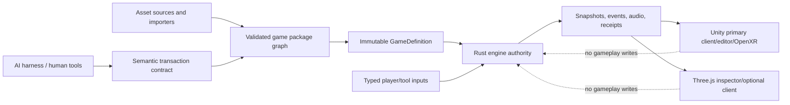
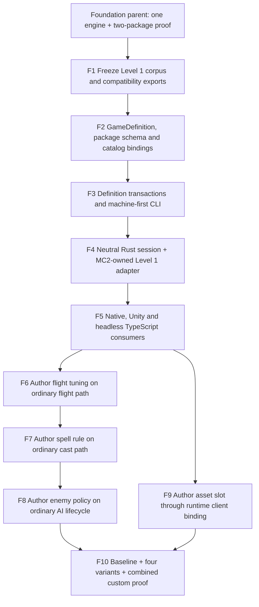

# Carpet Flight engine recovery and execution plan

Status: **F1-F10 semantic foundation implemented and independently qualified;
later capability work follows the dependency graph and bounded no-claims below.**
Decision authority: [`program-charter.md`](program-charter.md), binding operator
direction dated 2026-08-21.
Plan owner and consumer: Oliver and agents planning or executing Carpet Flight
work in this repository.

## Why this document exists

This is the single plan that will be revised in place through architecture
recovery, Beads reconciliation, and dependency validation. It gates activation
of further broad campaign-porting or successor work.

- **Observed defect:** repository instructions and 495 deferred successor Beads
  encoded a separate clean-slate product while active work continued
  level-by-level porting. Repeated conversations consequently produced changing
  architectures and failed to prioritize the AI-authoring surface.
- **Gate:** no new engine implementation wave or broad Level-N porting wave is
  ready until this plan contains the evidence-backed architecture, conformance
  gates, AI API contract, credible bridge, and a validated Beads graph.
- **Retirement condition:** after the accepted plan has been implemented and
  its product contracts are enforced by code and tests, retain only the durable
  architecture and operator-facing material; archive or remove recovery-only
  checklists with Oliver's approval.

## Binding destination

Carpet Flight is one private, extensible, remc2-derived Rust/Unity engine. Its
first canonical game configuration is privately playable MC2 using Oliver's
owned assets. The same engine must support replacement assets, reskinning,
retuning, changed rules and enemy AI, new worlds, and eventually a substantially
different game.

Permanent roles:

- remc2 plus the successful Rust port are the canonical seed implementation;
- Rust `sim-core` is the sole authoritative simulation;
- a typed, versioned semantic API is the sole AI-harness control surface;
- Unity is the primary player/editor and future OpenXR/VR shell;
- Three.js is an inspector, rapid harness, and optional browser client using
  the same API, never a second gameplay authority;
- private `MC2-owned` is the first package; a custom package must prove that
  the engine is not permanently hard-wired to MC2; and
- distribution review is a later release gate, not the current architecture.

The critical-path change is API-first extraction around the working Level 1
route. Later campaign work must populate package data or add a reusable engine
capability through the neutral API. It must not create another Level-N engine
or ABI authority.

## Evidence baseline — 2026-08-21

- Repository revision at recovery start:
  `b989344f7a76f903d34fedef25855addb616c845` on `main`, tracking
  `origin/main`.
- Pinned submodules: `magic-carpet-2-hd` at
  `6806c7204d17220ecc0430759f784aea8ee2ddb2`; nested `findfirst` at
  `2c4733bb77cb3357c691c7a6b7a46baeed2d5fe1`.
- Pre-existing dirty tracker file: `.beads/issues.jsonl`, three changed records
  (`mc-6dqd.1.1`, `mc-jmcp`, `mc-uptb.1`). They contain late Level 2 wind-down,
  acceptance, and blocker comments/status written after HEAD. Preserve and
  reconcile them; do not overwrite, revert, or treat them as this recovery's
  edits.
- `br list --json --limit 0` reports 762 live issues: 714 deferred, 44 open,
  2 blocked, and 2 in progress. All 495 issues labeled
  `parked:carpet-flight` are deferred. The two in-progress issues are
  `mc-6dqd.1.1` and `mc-uptb.1`, both Level 2 Nyphur work.
- Fresh focused Rust receipts in the `sim-capi` crate at the starting revision:
  `native_v2::campaign_facade::tests::sealed_level1_open_step_reset_replays_existing_hashes`
  passed 1/1, and
  `native_v2::tests::level2_campaign_step_is_revisioned_reset_safe_and_keeps_level1_abi_untouched`
  passed 1/1. The Level 1 test compares two executions of a default/no-op
  command and pins no accepted digest; it proves self-consistency of that
  internal adapter, not compatibility. Neither test crosses a public native
  ABI. They do not prove full playability, Unity, general authoring, or campaign
  completion.
- The repository's reused default Cargo target initially invoked a build-script
  artifact containing a stale retired-worktree path. Rebuilding in fresh target
  `/tmp/magiccarpet-reality-check-bS8yCb` succeeded. Do not mistake the stale
  cache failure for simulation behavior or silently count it as a green build.
- Local, ignored integration artifacts exist:
  `research/private/remc2-unity-native/Builds/Linux/MagicCarpetNative.x86_64`
  (2026-08-01) and
  `Assets/Plugins/x86_64/libsim_capi.so` (2026-08-16). They were not freshly
  executed for this planning task. `gh release list --repo odcpw/magiccarpet`
  returned no releases; there is no shipped/deployed Carpet Flight release.

## Evidence-first assessment

Statuses mean exactly: **working** = reproduced or accepted behavior exists on
the real repository route; **partial** = useful real behavior exists but does
not meet the whole goal; **stubbed** = a shape or data carrier exists without
the intended end-to-end capability; **unproven** = evidence at the current
revision is insufficient; **missing** = no implementation was found;
**regressed** = a formerly evidenced capability now fails; and **wrong
approach** = the implementation direction cannot satisfy the binding goal
without being reframed. Repository reality and shipped reality are deliberately
separate.

| Material goal | Repository status | Concrete evidence and limit | Shipped/deployed status |
|---|---|---|---|
| remc2 is the canonical source implementation for carpet flight | **working** | The pinned remc2 checkout is the exporter build input; the exporter replaces only the entry point and retains the upstream engine sources and initialization (`remc2-level-exporter/README.md:3-17`). | **missing** — no release was found. |
| One authoritative Rust simulation reused by Unity and later clients | **partial** | Rust owns real deterministic Level 1 and Level 2 state, snapshots, hashes and events. Unity consumes the C ABI. Level 1 and Level 2 still have separate public/session shapes, and the new campaign carrier explicitly projects remaining domains from the old Level 2 authority (`campaign/state.rs:1-5,272-319`). | **missing** |
| Privately playable MC2 with Oliver's owned assets | **partial** at the current revision | Accepted repository evidence and local player/plugin/package artifacts exist; fresh focused Level 1 Rust/C-ABI open/step/reset passed. This task did not freshly launch the Unity player, so current-revision desktop play remains unproven here. | **missing** as a published/deployed product; owner-local artifacts are not a release. |
| Owner-data exporter and deterministic asset cache | **working** for the sealed MC2 path; **partial** as a general pipeline | The exporter emits a pointer-free v3 package for external levels 1–25 (`remc2-level-exporter/README.md:47-52,83-142`). Closure/cache code binds exact owner files, identities and hashes. Level 2 final-frame closure is explicitly unresolved (`remc2-level-asset-closure/README.md:57-63`). | **missing** |
| Neutral game packages rather than Level-N engines | **missing** | Current packages are MC2/source-shaped. No neutral `GameDefinition` and no second custom package are implemented. | **missing** |
| Typed AI API that can discover and modify every supported working parameter | **missing** | No semantic `describe/get/set/validate/apply/diff/rollback` transaction surface was found. The C ABI is a strong machine transport, but it exposes sessions and many level/source-specific projections rather than a complete authoring catalog. | **missing** |
| Flight tuning, spell rules, enemy policy and asset replacement without engine edits | **partial/stubbed** | Typed flight/content fields and substantial rule/AI implementations exist, but important values are compiled constants—for example fireball speed, cost and damage in `level1_mission.rs:1762-1796`. Asset manifests are identity-pinned rather than replaceable by stable semantic slot. | **missing** |
| A neutral runtime session contract | **partial** | `InternalCampaignAdapter` and `SealedLevel1Adapter` demonstrate a real open/step/reset lifecycle in the `sim-capi` transport layer (`campaign_facade.rs:29-125`). They return ABI-shaped `McSessionSnapshotV2`/`AbiResult`, have no public native entry point, and lack neutral definition, discovery and mutation contracts. The canonical domain seam is therefore still missing. | **missing** |
| Current public `mc_native_campaign_*` ABI as the general engine API | **wrong approach** | Its Level 1 variant contains only an immutable world; reset mutates only Level 2 and step rejects non-Level-2 sessions (`campaign_abi.rs:132-142,542-560,1374-1516`). Preserve its useful ABI mechanics, but do not bless its semantics as neutral. | **missing** |
| Unity primary player/editor and future VR shell | **partial** | The native Rust-to-Unity desktop route, managed wrappers and presentation composition are real. The composition is strongly Level 1/Level 2-specific; no current OpenXR/VR runtime proof was found. | **missing** |
| Three.js inspector/harness using the same engine contract | **stubbed/unproven** | Historical `sim-wasm`/`web` proof surfaces exist, but they are parked and do not consume the intended neutral semantic contract. | **missing** |
| Whole MC2 campaign through one reusable engine | **partial** | A substantial Level 1 route and an incomplete Level 2 route exist. Later levels and full campaign capability closure are not delivered. | **missing** |
| Decomposition of the Rust/Unity monoliths | **partial** | Focused modules, an internal adapter and a campaign carrier exist, but `level1_mission.rs` is 45,127 lines, `MagicCarpetRuntime.cs` 12,161, `native_world.rs` 9,701 and `campaign/level2.rs` 8,641. Broad decomposition before the semantic seams are fixed would be the **wrong approach**. | Not applicable |
| AI-assisted generated assets with faithful import, validation and rollback | **missing** end to end | Exact owned-asset decode/cache machinery is reusable, but no concept-art-to-runtime asset authoring contract or semantic replacement/rollback path is implemented. | **missing** |
| Voxel destruction, real-city worlds and water-like simulation | **missing** as product capability | Useful world-provider and future-design documents exist; no evidence establishes the intended runtime capabilities. | **missing** |
| Independent commercial successor/rebrand | **unproven** | The reusable seed is substantial, but the custom-package proof, asset replacement pipeline, neutral authoring API, original content and release boundary have not been delivered. The prior separate clean-slate C#/browser-first program is a **wrong approach** for the now-binding direction. | **missing** |

No reproduced regression was found in the two focused Rust/C-ABI contracts run
for this assessment. That is a narrow statement: it does not certify Unity,
full Level 1 play, Level 2 completion, or any shipped product.

## Current production route and extraction seam

```text
owned MC2 data
  -> remc2 alternate exporter
  -> pointer-free owner-level package
  -> reachable-asset closure and decoded owner cache
  -> Rust NativeWorld + SessionRecord + Level1MissionState
  -> sim-capi handles, snapshots, events and audio
  -> Unity NativeSession
  -> MagicCarpetRuntime presentation/player
```

What should remain behind the new boundary:

- remc2-based import, one-based-to-zero-based mapping and source provenance;
- deterministic package member hashing, owner-data closure and decoded cache;
- Rust fixed-width/wrapping behavior, ordering, RNG, state hashing and reset;
- the sealed Level 1 `SessionRecord` and `SealedLevel1Adapter` during extraction;
- handle, generation, struct-version, cursor, capacity and typed-error mechanics
  from `sim-capi`;
- Unity input/presentation/audio/HUD behavior that consumes Rust observations;
  and
- accepted Level 1 hashes and event order as compatibility observations, not as
  a new authoring schema.

What is compatibility-shaped and must be adapted rather than exposed as the
engine's permanent language:

- `Level1MissionState`, Level-1-only C symbols and exact-cache environment
  setup;
- `Level2ResetSession`, Level-2 family/event sidecars and hard-pinned managed
  package dictionaries;
- remc2 numeric class/model/action/slot identities;
- source-file/member layouts and raw presentation selectors; and
- any API whose public identity contains a level number.

`InternalCampaignAdapter` proves that open/step/reset can wrap the sealed Level
1 route, but it is a transport-bound prototype in `sim-capi`, not the neutral
seam: it exposes ABI result and snapshot types. The bridge extracts the same
lifecycle into `sim-core` or a focused Rust domain crate as the canonical
`GameAdapter`/`GameSession` contract. `sim-capi` then wraps that contract. The
sealed Level 1 implementation stays intact behind the adapter; the bridge does
not begin by moving the 45,127-line mission file or completing the Level 2
campaign fold.

## Current modification surface

| Surface | What exists | What is absent from the intended contract |
|---|---|---|
| Flight | `FlightProfile`, `PlayerCommand`, `FlightWorld`, mutable session flight state | Discoverable semantic IDs, units/bounds/defaults and transactional changes |
| Assets | Deterministic importer, closure, cache, hashes, decoded frames/audio | Stable slots, replacement validation, transform recipes, hot/reload timing and rollback |
| Spells and rules | Faithful compiled Rust constants and handlers with tests | Package-supplied rule values/graphs and capability reporting |
| Enemy AI | Authored aggression/reflex/perception/spell/life fields plus source-shaped handlers | Replaceable policy definitions with bounded deterministic behavior |
| Terrain/world | Mutable session terrain and a renderer-free world seam | Neutral world-provider package, streaming/persistence contract and voxel provider |
| Behavior | Closed compiled source-site registry | Versioned declarative behavior library or safe compiled capability extension |
| Runtime observations | Versioned C layouts, handles, snapshots, events, audio, generations/cursors; current Level 1 presentation reads also commit feedback later consumed by simulation | One client-neutral snapshot/event/input schema, plus a Rust-owned presentation lifecycle whose polling frequency cannot alter gameplay |
| Authoring | Exact package/cache validators | Parameter discovery, atomic change sets, validation, diff, apply and rollback receipts |

## Contradiction and document reconciliation map

The repository currently contains six material contradictions that must be
removed before implementation dispatch:

1. one engine versus two products/repositories;
2. Rust authority versus a clean-slate C# authority;
3. `MC2-owned` as the first package versus explicit exclusion of MC2;
4. Unity primary/Three.js optional versus browser-first as the release gate;
5. API-first extraction around Level 1 versus Level-2-first work selection; and
6. one private implementation versus Track-P-to-Track-S transfer machinery.

“Retire” below means remove governing force and preserve useful history; it
does not authorize destructive deletion.

| Document or group | Decision | Retain / change |
|---|---|---|
| `program-charter.md` | **rewrite in place** | Keep the binding destination, player ambitions and authority split; remove the contradictory two-track body and separate-repository topology. |
| `AGENTS.md` | **rewrite now** | Keep executable checkout, pipeline, invariants and verification truth; remove residual Track S and Level-2-first dispatch wording and point to the minimal canonical set. |
| `README.md` | **rewrite** | Keep implementation inventory and accepted Level 1 receipts; describe the one-engine repository and distinguish current local proof from release. |
| `product-promise.md` | **rewrite heavily** | Keep player fantasy, original-world, VR/city/destruction ambition and capability floor; replace two-deliverable, clean-slate and browser-first premises. |
| `modular-engine-game-module-contract.md` | **rewrite as the canonical engine/package/API contract** | Keep deterministic laws, package/capability families, graph constraints, session identity, saves/replays and synthetic conformance; make `MC2-owned` first and add the semantic transaction contract. |
| `stack-decision.md` | **rewrite heavily** | Fix Rust as simulation authority, Unity as primary client/editor/OpenXR shell and Three.js as inspector/optional client; retain Unity/editor, Blender and determinism constraints. |
| `provenance-policy.md` + `private-public-boundary.md` | **narrow and consolidate authority** | Keep private owner-data containment, source/asset manifests, service egress controls and future release gates; remove internal clean-room transfer and nonexistent separate-engine rules. |
| `preservation-track.md` | **retire as a governing track** | Preserve pinned-source, fidelity, deterministic replay and owner-import guidance as MC2 compatibility/conformance material. |
| `document-alignment-register.md` | **retire after reconciliation** | Preserve as dated historical evidence only; it must no longer define the repository graph or work taxonomy. |
| `successor-stack-pin.md`, `platform-portability.md` | **rewrite/demote** | Retain checked Unity/tooling pins, automation, asset export, failure behavior and OpenXR notes; remove C# simulation and browser bakeoff authority. |
| `behavioral-reverse-engineering-protocol.md` | **rewrite** | Keep falsifiable source/runtime correlation and invalidation; route evidence directly into this private engine rather than a clean-room handoff. |
| `prototype-distribution-and-licensing.md` | **demote to later release appendix** | Keep reversible dependency/asset/contribution gates; it does not gate private engine work. |
| browser, multiplayer, VR, world/voxel and city contracts | **keep as subordinate capability contracts** | Reconcile terminology and milestone ordering; none may become a competing engine or immediate release gate. |
| campaign seam/folding research and measured state inventories | **keep as technical evidence, not work-selection authority** | Retain one-owner state, compiled registry, descriptor, reset/hash, generic ABI and temporal lifecycle findings; supersede Level-2-before-API ordering. |
| archived pre-reset documents | **keep archived; mine selectively** | Some one-engine/package concepts align, but their clean-slate/browser premises do not return as authority. |

The permanent canonical document set after reconciliation is intentionally
small: charter, product promise, engine/package/API contract, stack decision,
and private-data/future-release boundary, with `AGENTS.md` and `README.md` as
operational summaries. This recovery plan is temporary and retires per its
creation gate.

## Frozen semantic architecture

The machine-checkable companion
[`carpet-flight.semantic-model.json`](carpet-flight.semantic-model.json)
separates operator intent, the repository at the recovery revision, and the
planned foundation candidate. `kerf-model analyze` reports 3 subjects, 58
entities, 43 relations and zero blockers, errors or warnings at model hash
`724671917d455898cc67ee7fcd834f9059becac3817152bb2c3127592f519caf`.
`derive-work` emits ten declared capability units and an acyclic dependency
graph without mutating Beads. Structural validity and graph acyclicity do not
prove implementation or product readiness.

No finite Kerf behavioral projection is claimed yet. The transaction and
package specifications below are planning contracts, not an executable state
machine. Creating a toy projection now would raise no decision; the first
legitimate projection is the implemented transaction protocol or the bounded
Level 1 compatibility observation model.

### Stable vocabulary

| Term | Meaning |
|---|---|
| **Engine** | The Rust crates that validate definitions, own simulation state, execute deterministic capabilities, and produce authoritative observations. |
| **Compatibility adapter** | A bounded translator from a source-shaped implementation or package into the neutral contracts. It may preserve remc2 identities internally but may not leak a Level-N public authority. |
| **Game package** | A content-addressed, versioned dependency graph selecting definitions and required capabilities. It contains data and references, never arbitrary native code disguised as content. |
| **Game definition** | The immutable validated semantic model assembled from one game package: tuning, rules, behavior bindings, worlds, presentation bindings and asset slots. |
| **Rules profile** | Typed deterministic values and formulas that parameterize an already implemented engine capability. |
| **Behavior library** | Versioned declarative behavior nodes plus bindings to named compiled capabilities. It is not arbitrary generated Rust or raw remc2 dispatch bytes. |
| **World pack** | Data and provider selection for terrain, objects, streaming cells and edits. The first provider is the MC2 heightfield; future voxel/city providers obey the same world-query/edit envelope. |
| **Presentation pack** | Client-facing recipes that map authoritative observations to visual, audio, HUD and comfort behavior without writing gameplay state. |
| **Asset source** | Owner file, generated image/model/audio, or other provenance-bearing source artifact before deterministic transformation. |
| **Runtime asset** | Validated, content-addressed output bound to a stable semantic asset slot. |
| **Capability** | A typed engine function with a stable ID, version, declared inputs/outputs, deterministic constraints and availability. Compiled capabilities change only with an engine build. |
| **Client** | A consumer of typed commands, snapshots, events and presentation bindings. Unity is primary; other clients have no simulation authority. |
| **Inspector** | A client optimized for discovery, editing, diffing, replay and visualization. Three.js is the intended rapid inspector and optional browser client. |
| **AI harness** | An agent-facing orchestrator using the same semantic operations as human tooling. It receives typed schemas and receipts; it never edits process memory or scrapes decorative UI. |

### Authority and state invariants

1. Rust is the sole writer of live simulation state. Every gameplay mutation
   occurs through a typed input, validated definition change or compiled engine
   capability.
2. A package validator is the sole producer of an accepted immutable
   `GameDefinition`. Unity, Three.js, importers and model tools submit inputs;
   they do not become definition authority.
3. A semantic transaction coordinator is the sole commit point for authoring
   changes. A workspace points to one immutable definition revision and its
   content-addressed package/artifact graph. Validation builds a candidate
   without publication. Apply compare-and-swaps the workspace from an expected
   definition revision/hash to that candidate and journals the receipt.
   Rejection preserves every authoritative root. Rollback is a new forward CAS
   transaction to a retained prior graph; it is never an unconditional history
   reversal.
4. Runtime identity is at least:
   `(engine_contract, package_graph_hash, definition_hash, session_id,
   generation, tick)`. Snapshots, events, saves, replays and authoring receipts
   bind the relevant subset explicitly.
5. Source IDs, slots, class/model/action keys and source file layouts may remain
   inside the `MC2-owned` compatibility adapter. External authoring uses stable
   semantic IDs. The adapter owns the mapping and its provenance.
6. Rust owns the deterministic presentation lifecycle. Client observation is
   read-only: zero, one or many presentation polls between identical steps must
   not change simulation hashes, gameplay events, RNG, notifications or the
   next step. Any feedback required by the source implementation is scheduled
   by Rust independently of client polling. Derived client caches carry an
   explicit definition/session revision and invalidation rule.
7. Determinism covers fixed-width/wrapping arithmetic, source-relevant order,
   RNG draw order, effect order, reset, serialization and hashes. A new
   authoring surface declares whether it participates in the deterministic
   identity.
8. No package or client may load arbitrary executable behavior. A genuinely
   new algorithm is a compiled engine capability with code review and engine
   rebuild timing, not a parameter mutation.



### Mutation classes and timing

| Class | Examples | Validation and timing | Boundary |
|---|---|---|---|
| **Tuning** | flight acceleration, mana cost, damage, perception radius | Typed scalar/enum/formula; bounds, units and dependencies mandatory. First bridge applies at transaction commit plus session reset. A field may later declare next-tick application only after order/hash tests exist. | No new algorithm or unbounded script. |
| **Content and assets** | asset slot, palette, animation recipe, sound, level/world data, entity archetype | Validate source provenance, transform recipe, runtime format, references and content hashes. Apply at package reload or session reset; presentation-only assets may hot-swap at a declared observation boundary. | Runtime asset bytes never become gameplay authority unless a typed simulation fact explicitly derives from them. |
| **Declarative behavior** | bounded decision graph, spell composition, enemy policy selection | Closed node/type vocabulary, bounded resources, total validation, deterministic evaluation and capability dependencies. Apply at package reload/session reset first. | No arbitrary code, hidden I/O, time, thread, network or client-state dependency. |
| **Compiled capability** | new physics model, voxel fracture solver, navigation algorithm, new behavior node | Rust implementation, tests, versioned capability ID and engine build. The descriptor includes dispatch phase/key, ordinary producer, handler, same-pass epilogue, following-pass cleanup/reclaim, authoritative read/write set, and RNG/event-order effects where temporal scheduling matters. | Not writable through `set`; the API can only discover availability and select/configure it. |

The API reports one of these mutation timings for every writable field:
`next_tick`, `transaction_commit`, `session_reset`, `package_reload`, or
`engine_rebuild`. The first bridge intentionally supports
`session_reset`/`package_reload` for simulation-affecting edits. Claiming live
mutation without lifecycle evidence is forbidden.

### Package and compatibility contract

Every package manifest must name:

- schema and package ID/version;
- compatible engine-contract range;
- canonical content graph hash;
- package dependencies and deterministic load order;
- compiled engine capabilities required; packages provide definitions, bounded
  graphs, assets and bindings, never compiled capabilities;
- rules, behavior, world, presentation and asset sections;
- stable semantic IDs and explicit source-compatibility mappings;
- provenance and distribution class per source artifact;
- save/replay compatibility and migration declarations; and
- validation limits for sizes, counts, graphs and resources.

Unknown required capability, schema member, dependency cycle, hash mismatch,
path escape, semantic-ID collision or unsupported migration fails before a
session is created. Optional capabilities are explicit; they never silently
fall back to Level 1 or another package.

`MC2-owned` is the first package adapter. It may bind exact owner-level exports,
closure/cache receipts and source facts, but the neutral engine never requires
clients to know those formats. A separate synthetic `custom-proof` package is
the generality witness. Level 2 and later MC2 content migrate only after both
packages pass the same contract.

### Client contract

The engine domain contract, C ABI, CLI, MCP/agent bridge, Unity managed wrapper,
Wasm and HTTP are separate layers. The domain contract consists of:

- generation-bound typed input commands;
- an idempotent complete snapshot for the declared projection;
- ordered, cursor-paged events/effects with expiry semantics;
- presentation bindings and Rust-owned lifecycle state that clients cannot
  advance merely by polling;
- reset and replay receipts; and
- typed version/capability negotiation and failure.

The C ABI may encode that contract for Unity; it does not define the semantics.
Three.js may consume a Wasm or process/HTTP transport; it does not cause a
second engine implementation. VR adds Unity input and presentation adapters
over the same commands and observations.

### Extension constraints

- Voxel destruction is a future compiled world/physics capability plus world
  and presentation packages. It does not replace the engine authority model.
- Real cities are streamed world packs over a provider-neutral query/edit and
  persistence contract; geography and generated assets remain provenance-bound.
- Water is a named deterministic simulation capability with bounded state and
  observations, not a renderer effect presented as gameplay.
- Generated art, structure, animation and audio enter through source artifacts,
  deterministic transforms where possible, semantic slots, validation and
  rollback. Model choice is replaceable; the contract is not.
- VR is a client capability. Head pose, controller actions, comfort state and
  rendering are Unity concerns unless a typed gameplay command crosses the
  input port.

### Forbidden drift

- no clean-slate C# gameplay simulation;
- no separate successor engine or presumed separate repository;
- no raw-memory, source-address or untyped string-key authoring API;
- no new `LevelNSession`, Level-N public ABI or per-level Unity authority;
- no Three.js/Unity gameplay fork;
- no exporter-generated Rust behavior;
- no broad monolith rewrite before a consumer contract owns the seam; and
- no broad campaign, voxel, city, multiplayer, VR or release wave before the
  first two-package proof closes.

## Planned conformance contract

The specification sources are the rewritten charter, the canonical
engine/package/API contract, and explicitly enumerated accepted Level 1
observations. remc2 is the source implementation for MC2 behavior, but current
accepted fixtures establish only their named corpus; they do not prove total
game equivalence.

### Fixture A — `MC2-owned/level1`

The real owner-data production route must open through the neutral package and
domain session contract, then cross a built external native ABI consumer to
step ordinary commands, copy snapshots/events/audio, reset, and replay. A
versioned Level 1 corpus manifest pins non-no-op command traces; exact accepted
state and conformance hashes; selected snapshots, events and audio; package and
cache identities; source revision; engine/plugin build identity; and
provenance. The same corpus runs through the sealed legacy route in the same
build as a differential check, but fixed accepted values remain authoritative
so two implementations cannot regress together. The current internal facade
self-consistency test is a seed, not this receipt. A direct setter,
fixture-created gameplay row, internal-only caller, or zero-test filter is not
acceptance.

### Fixture B — `custom-proof`

A synthetic, redistributable package uses the same engine contract and changes,
through semantic change sets only:

1. one stable presentation asset slot;
2. one flight tuning field with unit and bounds;
3. one spell rule used on an ordinary cast path; and
4. one enemy policy used on an ordinary perceive/decide/act path.

One byte-identical Rust engine/plugin build, Unity player build and headless
TypeScript reference-client build run the baseline, four one-factor variants,
and the combined custom package. Only a declared package-graph artifact
whitelist may differ. Each one-factor variant changes one predeclared semantic
observation under the same seed and command trace, preserves named
countermetrics, and returns to baseline when that change is removed. The flight
and spell values must be observed at their ordinary consumption sites. The
enemy case names one archetype and pins ordinary producer -> scheduler ->
perceive -> decide -> act -> same-pass epilogue -> following-pass cleanup. The
asset hash must reach an actual runtime client binding and cache invalidation
boundary. A changed fixture name, hidden test hook, package-specific client
branch, test-created actor, or compiled special case fails the proof.

### Atomic conformance requirements

The executable suite reports one verdict per requirement below. Every record
names its positive case, negative control, proof layer, fixture provenance,
discrepancy status and no-claim. Totals report required, exercised, passing,
expected-failing and uncovered clauses; uncovered is visible and never counts
as conformant.

| ID | Atomic required behavior | Decisive evidence or falsifier |
|---|---|---|
| `DEF-001` | Both packages validate to one versioned definition schema and canonical graph identity. | Unknown member, dependency cycle, ID collision, hash drift or path escape fails before publication. |
| `DEF-002` | The engine alone provides compiled capabilities; packages declare exact required versions. | Unknown/incompatible capability fails; a package claiming to provide executable capability fails. |
| `CAT-001` | Every authoring handler carries exactly one descriptor, and every writable descriptor has read, validate, apply and read-back bindings. | Duplicate ID, missing binding, catalog-only row or undiscoverable setter/export fails structurally. |
| `CAT-002` | An independently maintained required-surface census maps the bounded Level 1 flight, spell, enemy-policy and asset use sites to semantic IDs or explicit non-authorable dispositions. | A planted unregistered working constant or build-fingerprint/catalog drift must fail. This proves bounded product coverage, not every internal variable. |
| `TX-001` | `validate` and `diff` do not mutate any authoritative root. | Compare definition pointer, package graph, asset bindings, sessions, event/audio journals, cursors, presentation sidecars and transaction journal before/after. |
| `TX-002` | `apply` publishes one immutable candidate definition by CAS on expected definition revision/hash and returns recoverable read-back evidence. | Stale expected definition, duplicate-key/different-payload or fault before commit leaves every root unchanged. |
| `TX-003` | Existing sessions stay bound to their old definition until explicit reopen/reset binds the new one and advances session generation. | Two simultaneous sessions prove isolation; publication alone cannot alter either live hash. |
| `TX-004` | Definition, package graph, validated asset bindings and transaction receipt become visible at one defined commit point. | Fault injection before and after every durable boundary detects partial visibility; cancellation after commit resolves through `apply-status`. |
| `TX-005` | Rollback is a new guarded forward transaction to a retained prior content-addressed graph. | Stale current-definition guard or missing retained artifact refuses without mutation; no unconditional “previous” operation exists. |
| `L1-001` | A built black-box native consumer opens and runs the neutral Level 1 route with real owner inputs. | Internal-only call, adapter bypass, mock package or zero selected cases fails. |
| `L1-002` | The versioned non-no-op corpus matches fixed accepted hashes, events, audio and selected observations. | Any fixed-value/order/identity discrepancy fails; self-agreement alone cannot pass. |
| `L1-003` | Neutral and sealed legacy routes agree for the same corpus in the same build. | Differential mismatch fails, but agreement cannot override `L1-002` fixed evidence. |
| `CUSTOM-001` | The flight one-factor variant changes its named consumed flight observation and preserves named countermetrics. | Remove the change or bypass the ordinary consumption site and the effect must disappear. |
| `CUSTOM-002` | The spell one-factor variant changes its named ordinary-cast observation and preserves named countermetrics. | A UI-only value, direct effect setter or unrelated package difference cannot pass. |
| `CUSTOM-003` | The enemy-policy one-factor variant changes the named ordinary lifecycle observation. | Producer/scheduler/perceive/decide/act/epilogue/cleanup mismatch or test-created actor fails. |
| `CUSTOM-004` | The asset one-factor variant changes one typed slot through runtime binding/cache invalidation. | Catalog-only read-back, malformed slot signature or client special case fails. |
| `CUSTOM-005` | Combined custom and baseline runs use byte-identical engine/plugin, Unity and TypeScript executables; only whitelisted package artifacts differ. | Any executable/build hash or undeclared artifact difference fails. This proves four bounded extension surfaces, not arbitrary games. |
| `CLIENT-001` | Native/Unity and headless TypeScript adapters round-trip the same fixed command/snapshot/event domain vectors. | Compare canonical normalized semantic values and digests, not transport bytes; unknown gameplay fields must fail. |
| `CLIENT-002` | Client polling is observational. | Zero, one and N presentation reads between identical steps must yield identical simulation hashes, RNG and ordered gameplay events. |
| `ASSET-001` | Every authored asset binds a typed slot signature: kind, format, dimensions, frame count, palette/color contract, animation timing, coordinates and dependencies. | Invalid signature, dependency, symlink/path, hash or transform fails before publication. |
| `ASSET-002` | Source artifact, deterministic recipe where applicable, runtime artifact and client binding are provenance- and content-addressed. | Generative output is hashed at capture; model byte reproducibility is not claimed. Failed publication preserves the prior binding. |
| `ARCH-001` | A frozen baseline manifest records existing Level 1/2 native exports, Rust public AST, managed reflection and TypeScript exports with owner and retirement disposition. | Missing baseline ownership/disposition fails the guard setup; legacy names are not silently blessed as neutral. |
| `ARCH-002` | No new package-specific public symbol appears outside explicit compatibility namespaces, and neutral modules do not branch on Level-N identity. | A planted new `Level3Session`, package-ID gameplay branch or unregistered export fails structurally. Content names inside package data remain allowed. |
| `ARCH-003` | Unity/TypeScript have no gameplay writer and no hidden simulation field. | A planted client-side gameplay mutation fails; static evidence complements runtime polling/parity tests. |
| `ERR-001` | Deterministic domain errors are typed and preserve the declared roots. | Malformed package, unknown ID, bounds, capacity, cursor/session generation and definition conflict each report exact identity/path and state-unchanged evidence. Refusal does not prove positive capability. |
| `TRANSPORT-001` | CLI/MCP/HTTP timeout and cancellation are transport policy with idempotent commit recovery. | Cancel before commit preserves state; after commit, `apply-status` returns the receipt. Wall-clock timeout never becomes a simulation result. |

Fixture provenance binds the source revision, package/cache graph, build/plugin,
Unity version, invocation and result. Accepted differences are explicit and
reviewed; goldens are never regenerated merely to accept candidate behavior.
Only a non-empty real consumer route may close a positive capability.

## Agent-facing semantic API contract

This applies the agent-ergonomics principles to a new contract; it is not a
scorecard for an existing CLI, and therefore does not create the skill's audit
workspace or pretend an executable already exists. The domain API is designed
machine-first. Human tools render the same structured results.

### Contract layers

1. **Rust domain API — authority.** Typed request/result structures and
   transaction semantics live with the engine. This is the contract of record.
2. **Rust CLI — first harness.** Headless, scriptable access for conformance,
   AI agents and local iteration. JSON/NDJSON stdout is data-only; diagnostics
   go to stderr.
3. **C ABI — Unity runtime/editor transport.** Versioned bounded layouts and
   handles encode the domain contract where Unity needs them.
4. **MCP tools — optional AI transport.** Thin one-to-one tools plus one
   read-only preview macro. MCP does not add privileged mutation semantics.
5. **Wasm/process/HTTP — optional Three.js transport.** Same schemas, identities
   and receipts. Transport choice cannot change validation or gameplay.

### Stable operations

| Operation | Mutation | Required result |
|---|---|---|
| `capabilities` | none | Contract/engine versions, available package and compiled capabilities, operation schemas, mutation timings, limits, transports and error dictionary. |
| `describe` | none | Bounded catalog of parameter, asset-slot, rule, behavior, world and capability descriptors; filter by stable ID prefix, kind, writability or capability. |
| `get` | none | Current/default/effective values for requested stable IDs at an explicit definition/session identity. |
| `set` | stage only | Canonical change set; type-checks syntax but does not validate cross-field semantics or mutate a definition/session. The name is retained because it is the first operation an agent will guess. |
| `validate` | none | Deterministic dry-run verdict over a canonical change set, with all bounded errors/warnings, affected IDs/capabilities and required timing. |
| `diff` | none | Typed before/after semantic diff plus derived dependency and asset-graph changes. No free-form patch text is authoritative. |
| `apply` | atomic commit | Requires an accepted validation receipt, expected definition hash/revision and idempotency key; compare-and-swaps the workspace active-definition pointer and returns a committed read-back receipt or leaves every prior authority root unchanged. |
| `apply-status` | none | Resolves an idempotency key/transaction ID to not-started, staged, committed-with-receipt or failed-before-commit; required after transport interruption. |
| `rollback` | atomic commit | Creates a new validated candidate referring to an available receipt-bound prior content graph, then CAS-publishes it under an expected-current-definition guard. It never guesses “previous” or rewinds sessions. |
| `reset` | session mutation | Restores a session from its validated definition baseline, increments generation and returns the initial snapshot receipt. It does not edit the definition. |
| `snapshot` | none | Bounded projection of authoritative session state plus identity/hash, with cursor paging for events/entities and explicit completeness. |

`open`, `step`, event paging and close remain the adjacent runtime-session
contract. They share identity/error/envelope types but are not authoring aliases.

Two convenience macros reduce cheap-model round trips without expanding
authority:

- `inspect` returns quick identity, writable-surface summary, package/capability
  health, current session receipt and recommended next operations; and
- `preview` takes proposed changes and returns affected descriptors, validation,
  diff, timing and an exact guarded `apply` request. It never mutates.

### Descriptor schema

Every catalog entry contains, with stable field names:

```text
id                       semantic dotted ID
descriptor_version       schema version for this descriptor kind
kind                     tuning | asset_slot | rule | behavior | world | capability
value_type               bool | integer | fixed | enum | string | reference | record | list
unit                     explicit unit or null
default_value            package default or null for capabilities
effective_value          only when requested against a definition/session
bounds_or_enum            inclusive numeric bounds, length/count bounds or enum set
access                    read_only | writable
mutation_timing           next_tick | transaction_commit | session_reset |
                          package_reload | engine_rebuild
determinism_role          identity | observation_only | non_deterministic_forbidden
dependencies              stable IDs and required capability versions
side_effects              invalidated caches/sessions/assets and emitted effects
scope                     engine | package | world | archetype | instance | presentation
provenance                definition/package/adapter origin and content hash
temporal_contract         dispatch phase/key, ordinary producer, handler,
                          same-pass epilogue, following-pass cleanup/reclaim,
                          authoritative read/write set and RNG/event effects,
                          or null when the capability is not scheduled
deprecation               replacement ID and removal contract, or null
summary                   short literal description
examples                  small typed examples, never required for interpretation
```

IDs describe game meaning, not source layout: for example
`flight.player.max_forward_speed`, `spell.fireball.mana_cost`,
`ai.enemy.default.policy`, and `presentation.spell.fireball.projectile_asset`.
The MC2 adapter may map these to source constants/fields internally. An ID is
not writable merely because an internal variable exists. Catalog completeness
means every registry-declared *supported authoring surface* is described and
every writable descriptor has exactly one implementation binding.

Integers and explicit fixed-point values are preferred. Units and scale are
mandatory. JSON integers that may exceed interoperable 53-bit range are strings
with a declared numeric encoding. Untagged unions and ambiguous sentinel values
are forbidden.

### Change sets and receipts

A canonical change set contains:

```text
schema_version
target_workspace
expected_definition_hash
expected_definition_revision
idempotency_key
changes[]                    stable ID + typed replacement + optional expected value/hash
requested_timing
intent                       optional non-authoritative note
```

The operation vocabulary is intentionally small: replace one semantic value or
bind one stable reference. List/graph edits are replacements of validated typed
substructures, not a general raw JSON Patch against internal serialization.
Changes are sorted canonically before hashing. Repeating an `apply` with the
same idempotency key and identical change-set hash returns the original receipt;
reusing the key with different bytes is a conflict.

Validation receipts bind:

- contract/engine/schema versions;
- canonical change-set hash, target workspace and expected definition
  hash/revision;
- affected stable IDs, dependencies and capabilities;
- required mutation timing and whether a session reset/reload is necessary;
- validation verdict and complete bounded diagnostics; and
- validator identity and receipt hash.

Apply/rollback receipts add transaction ID, prior and resulting definition
hashes/revisions, prior and resulting package/artifact graph hashes, commit
point identity, mutation timing, affected existing sessions and their unchanged
bindings, applied stable IDs, idempotency key and read-back hash. Publication
does not alter a live session: explicit reopen/reset selects the new definition
and advances that session's generation. A successful transport call with a
rejected validation verdict is not an accepted change. A committed result is
not success until read-back matches its result hash.

### Machine envelope and bounded output

Every transport provides the same logical envelope:

```json
{
  "ok": true,
  "contract_version": "1.0",
  "engine_version": "...",
  "request_id": "content-or-idempotency-derived",
  "data": {},
  "identity": {
    "package_graph_hash": "...",
    "definition_hash": "...",
    "session_id": null,
    "generation": null,
    "tick": null
  },
  "warnings": [],
  "errors": [],
  "recommended_operations": []
}
```

The canonical data bytes are deterministic for identical inputs; volatile
latency or wall-clock diagnostics are separate metadata and excluded from
semantic receipt hashes. Optional fields use explicit `null` consistently.
Large lists use a default limit of 100, a hard contract limit, stable sorting,
opaque cursors bound to the definition/catalog hash, `total` when cheap, and
`complete: true|false`. Sparse `fields` selection is supported. Long-running
asset transforms use NDJSON progress/heartbeat records and a terminal record,
but validation and publication receipts remain ordinary bounded objects.

The CLI's JSON mode emits the envelope on stdout and diagnostics on stderr.
Empty read results are successful empty arrays, not errors. Bare/interactive UI
is never required. `capabilities` and per-operation schemas are discoverable
without network access.

### Error contract

Errors are discriminated records with:

```text
code, message, path_or_id, operation, retryable, state_changed,
remediation, safe_alternative, expected_identity, actual_identity
```

The initial stable categories are:

| Category | Examples | Retry semantics |
|---|---|---|
| `INVALID_REQUEST` | malformed schema, unknown field, empty change set | fix input; not retryable unchanged |
| `UNKNOWN_ID` / `READ_ONLY` | nonexistent descriptor or compiled capability passed to `set` | inspect/describe; no state change |
| `TYPE_MISMATCH` / `OUT_OF_RANGE` | wrong type, unit, enum, bound or graph limit | fix value; no state change |
| `DEPENDENCY_FAILED` / `CAPABILITY_UNAVAILABLE` | unsatisfied reference or engine capability | change package/engine; no state change |
| `PACKAGE_INVALID` / `HASH_MISMATCH` | member, graph, provenance, traversal or content identity failure | repair input; no state change |
| `DEFINITION_MISMATCH` / `CONFLICT` | stale workspace definition guard or idempotency-key reuse | re-read then rebase; no hidden retry |
| `GENERATION_MISMATCH` | stale live-session command, snapshot or cursor identity | refresh/reset the named session; unrelated to authoring CAS |
| `UNSAFE_TIMING` | edit requests a lifecycle earlier than its descriptor permits | use returned reset/reload operation |
| `CAPACITY` / `CURSOR_EXPIRED` | bounded buffer/page or journal retention issue | retry with returned sizing/fresh cursor |
| `IO` / `INTERNAL` | environment or invariant failure | typed diagnostic; state_changed must be explicit |

Each error teaches the next exact operation with structured arguments. It does
not merely say “see help.” Mutations offer `validate`/`preview` as the safe
alternative. Fatal failure produces non-success status; it never silently
returns empty data.

### Cancellation, recovery and concurrency

- Core read/validate/diff operations are deterministic and stateless/idempotent.
  CLI/MCP/HTTP adapters may add deadlines and cancellation as transport policy;
  timeout is never a domain or simulation result.
- Apply/rollback are short atomic publications over the workspace's immutable
  definition pointer. Cancellation before commit preserves every authoritative
  root; after commit the caller receives or recovers the receipt through
  `apply-status` and the idempotency key.
- Long asset import/transform runs have stable run IDs, content-addressed
  checkpoints, `status` and `resume`; writes use staging plus atomic publication.
- Interrupted or corrupt staged state is quarantined, never silently deleted or
  promoted.
- Optimistic expected definition hash/revision guards resolve concurrent
  authoring edits. Session generations separately guard runtime observations
  and commands. A conflict returns current identity and a recommended
  `get`/`diff`; it never last-writer-wins silently.
- Secrets, external-service credentials and owner-local paths are not embedded
  in portable packages or receipts. External model invocation is explicit and
  its provider/model/input/output provenance is recorded.

### Cheap/local-model usability bar

The first likely operation works (`describe`, `get`, `set`, `preview`) or returns
a precise correction. A small model can complete the four-surface custom proof
using:

1. one `inspect` call;
2. one bounded `describe` query for the four stable IDs;
3. one batched `preview` call; and
4. one guarded `apply`, followed by reset/snapshot verification.

No step requires parsing source, remembering numeric remc2 IDs, scraping Unity,
or inferring units. Responses put IDs/verdicts/next operations first, keep prose
short, expose complete schemas, accept batched changes, and remain bounded.

## Shortest credible implementation bridge

This is the implementation sequence to encode in Beads. It is deliberately a
vertical bridge around real Level 1 behavior, not a fresh engine skeleton and
not a broad monolith decomposition. Each work unit delivers code plus a real
positive consumer and discriminating negatives. The recovery task itself stops
before executing any unit.

### Dependency spine



The F6 -> F7 -> F8 serialization is intentional. Flight and spell/AI work may
look independent semantically, but the current Level 1 implementation and
session composition are large shared files. Sequential ownership avoids two
writers reshaping the same state and hash surfaces. F9 may proceed in parallel
after F5 because it owns the external asset/cache and presentation binding
surface. Re-evaluate that only after the preceding slices expose genuinely
disjoint modules.

### Foundation-wide completion contract

The parent closes only when all F1–F10 children are accepted at one exact
revision and the following are simultaneously true:

- `MC2-owned/level1` passes fixed accepted corpus values through a built neutral
  native consumer, not only an internal Rust test;
- the package/catalog/transaction operations are discoverable and usable from
  the machine-first CLI without source knowledge;
- Unity and the headless TypeScript consumer agree on normalized domain values;
- presentation polling does not affect simulation;
- baseline, each one-factor variant and combined custom package use identical
  engine/plugin and client executable hashes;
- only the declared package graph differs, and each change has its named causal
  observation and countermetrics;
- rejected validation, stale CAS, asset failure and transport interruption do
  not partially mutate any authoritative root;
- no new Level-N public authority or client gameplay writer appears; and
- no child acceptance relies on a direct setter, fixture-only actor, hidden
  package branch, regenerated golden, zero-test filter or agent report.

The parent no-claim is explicit: this proves a neutral foundation with four real
authoring surfaces. It does not close whole-MC2, every authorable parameter,
general arbitrary-game support, production generated assets, VR, voxels,
cities, water, multiplayer or commercial release.

### F1 — Freeze accepted compatibility and public-surface baselines

**Why first.** The current facade test can co-regress because it compares two
executions. Public Level 1/2 symbols already exist, so an unqualified “no
Level-N API” rule is either immediately red or silently permissive. Both
baselines must be fixed before extraction changes them.

**Inputs.** Pinned remc2 revision; qualified owner Level 1 package/cache; current
fixed assertions such as reset state `0x9da4_bc91_af58_f3ce`, reset conformance
`0x77b9_6b82_492d_6f4b`, live conformance
`0x36bd_7f1d_df05_37b5` and terrain `0x1cb0_31cc_76e2_140e` in
`tests_split/level1_world.rs`; existing native/managed API layouts; accepted
Level 1 tests and artifacts.

**Owned logical surface.** A versioned `engine-conformance/level1` corpus and
runner; an existing-exports baseline covering native exported symbols, Rust
public AST, managed reflection and TypeScript exports; focused tests only where
needed to run those artifacts. No simulation rule edits.

**Deliverable.** A non-no-op command corpus with fixed expected snapshots,
hashes, ordered events/audio and identity metadata, runnable through the current
sealed production route; plus a structural manifest giving every grandfathered
package-specific public symbol an owner and keep/adapt/retire disposition.

**Acceptance.** The corpus fails on one planted expected-value/order mutation,
on a zero selected trace and on a different package/cache/build identity. The
surface guard fails on a planted new package-specific native, Rust public,
managed or TypeScript symbol outside compatibility namespaces. The corpus
manifest's initial values receive independent semantic/golden review; they are
not generated from the candidate under test.

**Focused verification.** Run the named non-empty existing Level 1 tests, build
`sim-capi`, run an external black-box probe against the built library, run the
structural negative fixtures, and record exact source/package/cache/plugin
hashes. Format/lint touched Rust. Review test/golden changes separately.

**No-claim/recovery.** This freezes a bounded compatibility corpus and existing
surface, not full MC2. A bad candidate is reverted as one owned change; accepted
legacy APIs remain available.

### F2 — Deliver the neutral definition, package and binding catalog

**Why now.** If the semantic registry is designed before the neutral definition
and package graph, it will mirror current source internals. This unit makes the
schema and catalog one real loadable capability.

**Inputs.** F1 manifests; current exporter v3 schema, closure/cache receipts,
campaign descriptor/source facts and closed registry/fold research; canonical
engine/package contract.

**Owned logical surface.** New focused Rust domain modules for package manifest,
immutable `GameDefinition`, semantic IDs/descriptors, compiled-capability
requirements and binding traits; `MC2-owned` adapter mapping; schema fixtures;
read-only `capabilities`/`describe`/`get` CLI paths. Avoid moving mission logic.

**Deliverable.** The real owner Level 1 inputs validate into an immutable
definition with canonical package/artifact graph identity. The initial required
surface census maps asset, flight, spell and enemy-policy consumption sites to
stable IDs. They begin read-only; F3 may make the next vertical target
definition-writable solely to prove publication, while F6–F9 separately prove
ordinary runtime consumption. Every binding has exactly one descriptor and
every descriptor has a binding/disposition.

**Acceptance.** `MC2-owned` loads; a synthetic schema fixture loads without owner
data; unknown fields/capabilities, dependency cycles, ID collisions, path
escapes, invalid provenance and hash mutation fail before definition creation.
The planted unregistered working constant and undiscoverable setter/export fail
the independent census/structural check. Packages cannot provide executable
capabilities.

**Focused verification.** Exact `sim-core` package/registry tests, CLI JSON
schema and bounded-output tests, affected exporter/cache validation suites,
format/lint and changed-code scan. Assert no Level-N public symbol delta beyond
the frozen F1 baseline.

**No-claim/recovery.** A validated definition/catalog does not prove mutation or
gameplay. The sealed legacy route remains the fallback until F4 is accepted.

### F3 — Deliver immutable definition transactions and the CLI authoring path

**Why now.** A waterproof harness needs atomic publication and recovery before
definition changes are allowed to affect gameplay. Session generation and authoring
concurrency must remain separate.

**Inputs.** F2 definitions/descriptors and content-addressed artifacts; current
cache staging/atomic-rename failure-injection patterns; machine envelope and
error contract above.

**Owned logical surface.** Rust workspace/definition store, artifact references,
staged change sets, validator/diff, CAS publisher, transaction journal and
idempotency lookup; CLI `set`, `validate`, `diff`, `apply`, `apply-status`,
`rollback`; deterministic JSON schemas and fault-injection tests.

**Deliverable.** A change set targets `expected_definition_hash` and revision,
creates a validated immutable candidate, publishes exactly once, exposes
read-back, and can forward-publish a retained prior graph. The CLI supports the
cheap-model inspect/describe/preview/apply sequence with data-only stdout.

**Acceptance.** Concurrent stale CAS fails with current identity; identical
idempotency retry returns the original receipt; key reuse with different bytes
fails; validation/diff do not mutate; fault injection before and after every
durable boundary proves atomic visibility of definition, graph, artifact
bindings and receipt; cancel-before-commit is unchanged and an interrupted
post-commit call resolves through `apply-status`. Rollback is a new revision.

**Focused verification.** Exact Rust unit/integration and CLI process tests,
including stdout/stderr/exit-code contracts, pagination and bounded diagnostics;
compare every named authoritative root; format/lint and changed-code scan.

**No-claim/recovery.** This publishes definitions but does not alter existing
live sessions. Removing the active pointer restores the sealed route; immutable
artifacts/receipts remain for diagnosis.

### F4 — Extract the neutral Rust session and bind `MC2-owned/level1`

**Why now.** The current `InternalCampaignAdapter` proves the lifecycle but
lives in `sim-capi` and returns ABI types. The permanent seam must be a Rust
domain contract before clients or authorable rules depend on it.

**Inputs.** F1 fixed corpus; F2 definition and package; F3 workspace/receipts;
current `SessionRecord`, sealed Level 1 adapter, mission state, events/audio and
presentation behavior.

**Owned logical surface.** A focused `sim-core`/domain `GameAdapter` and
`GameSession` contract; `MC2-owned` Level 1 compatibility adapter; canonical
commands/snapshots/events; explicit session-to-definition binding; Rust-owned
presentation lifecycle. `sim-capi` only wraps these outputs.

**Deliverable.** Open the real owner definition, run the fixed command corpus,
snapshot/page events/audio, reset/replay and explicitly rebind to a newly
published definition. Keep the legacy route in the same build for comparison.
Move source-required presentation feedback into Rust scheduling so reads are
observational.

**Acceptance.** Fixed F1 values pass via the neutral domain and built native
consumer; the legacy differential also agrees. Two sessions bound to the old
definition remain byte/hash stable after a new definition is published; only
explicit reset/reopen changes one binding/generation. Zero, one and N
presentation reads between identical steps produce identical simulation hashes,
RNG and ordered gameplay events. Stale session generations fail without
changing journals/sidecars.

**Focused verification.** Exact domain, `sim-capi` black-box and F1 corpus runs;
polling-invariance and two-session tests; package/cache identity negatives;
format/lint and changed-code scan. Do not run broad Level 2 work as evidence.

**No-claim/recovery.** This preserves the bounded Level 1 corpus, not every
mission behavior. The legacy adapter remains callable until final comparison is
accepted; no Level 1 state rewrite is required.

### F5 — Deliver native, Unity and headless TypeScript consumers

**Why now.** One Rust domain seam is not proven neutral until two unlike clients
consume it without inventing gameplay. Unity must stay primary without making a
polished Three.js renderer a blocker.

**Inputs.** F4 domain session/observations and native transport; current Unity
`NativeSession`, `NativeSim` and `MagicCarpetRuntime`; parked Wasm/web lessons.

**Owned logical surface.** Versioned neutral C ABI layouts and P/Invoke wrapper;
one Unity engine-session adapter integrated into the current player; one minimal
headless TypeScript reference consumer over the selected Wasm or process/HTTP
transport; shared canonical vector fixtures. Full Three.js rendering is not in
scope.

**Deliverable.** Both consumers negotiate versions/capabilities, submit fixed
commands, copy bounded snapshots/events/audio/presentation bindings and render
or report them without hidden gameplay fields. Unity continues to run the real
Level 1 presentation route.

**Acceptance.** Native, managed and TypeScript adapters round-trip canonical
normalized values/digests for fixed vectors; unknown gameplay fields/versions
fail; polling invariance holds from both consumers; C ABI buffer/cursor errors
leave all roots unchanged; the non-empty Unity EditMode selection and headless
TypeScript process pass against the exact same plugin build.

**Focused verification.** Rust C ABI tests and header/layout probe; release
plugin build/install; exact Unity EditMode runner with result/log validation;
headless TypeScript tests; F1 Level 1 corpus. Record plugin, Unity and consumer
build hashes.

**No-claim/recovery.** TypeScript proves contract consumption, not a finished
Three.js game. Unity visuals may differ from future clients while domain values
remain equal. Revert adapters without changing F4 authority.

### F6 — Make one flight parameter genuinely authorable

**Target.** `flight.player.max_forward_speed` (or the nearest existing
semantically equivalent consumed field if source inspection proves a different
name; update the descriptor and Bead before code).

**Inputs/dependency.** F5 complete; F2 census pins the exact Level 1 field,
units, fixed-point scale, bounds, default, derived dependencies, hash role and
ordinary command path.

**Owned logical surface.** Flight descriptor/binding, definition materialization
and the smallest existing Rust flight consumer; one package variant and focused
client observations. Do not create a parallel flight implementation.

**Acceptance.** Baseline and one-factor variant use identical executables and
seed/commands. The variant changes predeclared velocity/displacement observations
at the ordinary flight consumer while preserving tick count, RNG draws,
unrelated mana/spell/AI/event countermetrics and reset/replay determinism.
Removing the package change restores baseline. Out-of-range/unit/type/timing
changes fail before publication.

**No-claim.** One field does not make all flight physics authorable.

### F7 — Make one fireball rule genuinely authorable

**Target.** Prefer `spell.fireball.mana_cost`; bind the exact ordinary cast
consumption and any derived relationship found in `level1_mission.rs` rather
than replacing every fireball constant at once.

**Inputs/dependency.** F6 complete; F2 census and pinned Level 1 cast lifecycle.

**Owned logical surface.** Spell rule descriptor/binding, immutable definition
materialization, ordinary cast consumer and one-factor package/test. Avoid new
test setters or client-side mana logic.

**Acceptance.** With identical engine/client builds, seed and cast trace, the
variant changes exact mana debit/affordability on the ordinary cast path and
preserves projectile identity/trajectory/damage, RNG and unrelated events as
named countermetrics unless the descriptor explicitly declares a dependency.
Removing the change restores baseline; invalid/unsafe values fail before
publication; reset/replay is deterministic.

**No-claim.** This exposes one spell rule, not an arbitrary spell language.

### F8 — Make one enemy policy genuinely authorable

**Target.** `ai.enemy.default.policy` for one named Level 1 ordinary enemy
archetype and one bounded policy choice/value with a clearly observable decision.

**Inputs/dependency.** F7 complete; source and current Rust evidence pin
producer, scheduler/dispatch, perceive, decide, act, epilogue, following cleanup,
authoritative reads/writes and RNG/events.

**Owned logical surface.** Policy descriptor/binding, bounded declarative
definition or compiled-capability selection, existing ordinary AI consumer and
one-factor package/test. No generated code, arbitrary script or synthetic actor.

**Acceptance.** The baseline and variant materialize the same ordinary actor and
input world under identical executables/seed. Only the named policy input
changes; the predeclared target/decision/action observation changes through the
full lifecycle, named unrelated state/RNG/event countermetrics remain equal,
and removing the change restores baseline. Wrong lifecycle phase, unknown node,
resource bound, hidden I/O or stale definition fails.

**No-claim.** One bounded policy surface does not make every enemy behavior or
new algorithm data-driven.

### F9 — Replace one asset through a typed semantic slot

**Target.** `presentation.spell.fireball.projectile_asset` or another existing
Level 1 slot whose ordinary Unity binding is easier to prove without gameplay
semantics; record the final choice before implementation.

**Inputs/dependency.** F5 complete; current closure/cache validators and atomic
publication patterns; F2 asset descriptor; F3 transaction/artifact store.

**Owned logical surface.** Source artifact intake, typed slot signature,
deterministic transformation/validation, content-addressed runtime artifact,
package binding, Unity cache invalidation and headless consumer observation.
Use a small independently authored synthetic source asset; production imagegen
is later.

**Acceptance.** The one-factor package changes the runtime content hash and
actual Unity/TypeScript presentation binding under identical executables. Slot
kind/format/dimensions/frames/palette or color/animation/coordinates/dependencies
are validated. Tamper, symlink/path escape, missing dependency, hash drift and
fault before/after publication preserve the old binding. Forward rollback
restores the retained prior artifact graph. Simulation hash/RNG/gameplay events
remain named countermetrics.

**No-claim.** This proves replacement plumbing, not model quality, automated
faithful pixel-art conversion, rigging or a production asset library.

### F10 — Close the two-package independence proof

**Why last.** This is the first point where package extensibility, semantic
transactions, real gameplay consumption, assets and two clients meet. It must
not add engine behavior to make its own fixtures pass.

**Inputs.** Accepted F1–F9 receipts and package variants.

**Owned logical surface.** `custom-proof` package graph, combined fixture,
qualification orchestrator and final evidence bundle. Engine, Unity and
TypeScript gameplay/client sources are read-only in this unit.

**Acceptance matrix.** Run baseline, four one-factor variants and combined
custom package under the same seed/command traces. Require:

- identical Rust engine/plugin, Unity and TypeScript executable hashes;
- only whitelisted package/artifact graph differences;
- each F6–F9 causal observation and countermetrics independently green;
- combined observations equal the declared composition of the four changes;
- deterministic reset/replay and explicit definition/session identities;
- Unity plus headless TypeScript normalized domain parity;
- malformed/stale/partial variants fail without root mutation; and
- complete atomic requirement totals with zero uncovered foundation MUSTs.

**Focused verification.** One orchestrated non-empty qualification run owns the
expensive final consumer gates; child workers do not all replay them. An
independent verifier re-runs the final candidate and inspects executable/package
hash inventories and all test/gate diffs.

**No-claim/recovery.** A combined package failure keeps F10 and the parent open;
do not split missing in-scope criteria into follow-ups. Revert only the custom
package/runner change; F1–F9 remain independently usable.

### After F10 — capability-driven campaign and product growth

F10 is the gate, not the destination. After it passes:

1. resume reusable campaign-fold leaves CF06–CF13 under the neutral definition,
   session and client contracts;
2. treat each MC2 behavior slice as package data or a compiled capability, and
   add a descriptor or explicit non-authorable disposition to the independent
   coverage census;
3. replace CF14's former “Level 3 proves generality” role—the custom package has
   already proved the boundary—then use later levels as content/capability reuse
   evidence;
4. close whole-MC2 only through a full campaign corpus and real Unity play route;
5. expand authoring coverage until every **supported working parameter** has a
   discoverable binding or explicit immutable/unsupported reason; and
6. activate original assets/worlds, production AI-assisted asset tools, VR,
   voxel/destruction/water/city providers and release work only as consumers of
   the accepted contracts.

Existing asset, AI, world, VR and destruction Beads may be rewritten/reparented
at that point. They are not foundation-ready merely because the graph makes them
mathematically central.

## Bridge risks and decision rules

| Risk | Early signal | Response |
|---|---|---|
| Neutral API mirrors remc2 internals | public IDs contain levels, slots, classes or source field names | keep mapping in `MC2-owned`; reject the public descriptor in F2 |
| A scaffold passes without gameplay | only schema/helper/direct-setter tests exist | keep the child open until the ordinary consumer crosses the real route |
| Catalog completeness is circular | registry and catalog generated from one list | require the independent consumption-site census and planted omission |
| Transactions partially publish | definition changes but artifacts/receipt/session sidecars disagree | fail F3; compare all roots at every injected boundary |
| Client polling changes state | 0/1/N read schedules produce different hashes/events | move lifecycle into Rust before any client bead closes |
| Custom proof is a hidden special case | engine/client build hashes differ or code branches on package ID | fail F10; only package whitelist may differ |
| Monolith extraction causes rewrite spiral | broad movement without a named consumer or fixed corpus delta | stop and return to the smallest domain adapter/binding seam |
| Level 2 backlog retakes priority | `br ready` surfaces campaign leaves before F10 | add/fix dependency on F10; do not implement the leaf |
| Asset generation claims too much | model output renders but slot/runtime/provenance path is absent | keep generation future; F9 starts from a captured synthetic artifact |
| Commercial concerns block private engine | release checklist appears in F1–F10 dependencies | remove it; retain only owner-data containment and later exact-artifact gate |

## Worker-ready packet rule

An F1–F10 Bead is actionable only when its description includes the inputs,
owned logical/filesystem surface, prerequisites, ordinary positive route,
negative controls, exact focused verification, no-claim and recovery rule above.
It must cite the plan section and current source locations. If implementation
discovery changes a target semantic field, temporal lifecycle or file boundary,
update the Bead and dependency graph before editing; do not silently widen it.

## Beads reconciliation and graph validation — 2026-08-21

The authoritative foundation graph now exists:

| Bridge unit | Bead |
|---|---|
| Aggregate parent | `mc-carpet-flight-semantic-foundation-z051g` |
| F1 compatibility corpus/export baseline | `mc-carpet-flight-semantic-foundation-z051g.1` |
| F2 definition/package/catalog | `mc-carpet-flight-semantic-foundation-z051g.2` |
| F3 transactions/CLI | `mc-carpet-flight-semantic-foundation-z051g.3` |
| F4 neutral Rust session/Level 1 | `mc-carpet-flight-semantic-foundation-z051g.4` |
| F5 native/Unity/TypeScript clients | `mc-carpet-flight-semantic-foundation-z051g.5` |
| F6 flight tuning | `mc-carpet-flight-semantic-foundation-z051g.6` |
| F7 fireball rule | `mc-carpet-flight-semantic-foundation-z051g.7` |
| F8 enemy policy | `mc-carpet-flight-semantic-foundation-z051g.8` |
| F9 asset slot | `mc-carpet-flight-semantic-foundation-z051g.9` |
| F10 two-package proof | `mc-carpet-flight-semantic-foundation-z051g.10` |

The aggregate is deliberately deferred/do-not-claim until its children pass.
F1 is open and worker-ready. F2–F8 form the serial dependency spine; F9 may
start after F5; F10 requires F8 and F9.

Non-destructive reconciliation performed through `br`:

- preserved the original late comments/status for `mc-6dqd.1.1`, `mc-jmcp` and
  `mc-uptb.1`; the two in-progress Level 2 leaves retain their status and gained
  one explicit F10 gate/comment;
- gated the four previously ready non-foundation tasks behind F10 or deferred
  the cosmetic rename, so none can be claimed first;
- labeled the old two-track, separate-repository, C# simulation, browser
  challenger and old two-module independence roots
  `superseded:one-engine-2026-08-21` with explanatory comments;
- linked closed campaign research/fold evidence to F2/F4 as non-blocking
  `related` evidence; and
- labeled and gated selected reusable asset, AI, world, destruction, FrankenSim
  and OpenXR concepts `retained:post-foundation` rather than duplicating or
  deleting them.

Validation after `br sync --flush-only`:

- 1,205 JSONL records exported with no sync errors;
- `br dep cycles --json`: zero active cycles;
- `br ready --json`: exactly one result, F1;
- `bv --robot-next`: F1, actionable, data hash `f3d5446395d479d0`;
- `bv --robot-plan --label engine-foundation`: F1 is the highest-impact item;
- `bv --robot-insights`: zero cycles, graph density approximately `0.002146`,
  F1 is the top new keystone/influencer, F1–F10 form the first reported long
  critical path, and F10 is an articulation point/unlock boundary; and
- the semantic work derivation independently reports an acyclic ten-unit graph
  with zero model findings.

`bv --robot-plan` counts the deferred aggregate in its displayed track, so
actual claims must continue to use `br ready`/`bv --robot-next`. Global
betweenness/PageRank also retain old deferred C#/browser centrality because the
historical 1,194-record graph and its edges were preserved. Those records are
now explicitly superseded/deferred and do not appear in readiness. Deleting or
rewiring hundreds of historical edges solely to make a prettier metric would be
tracker ceremony and evidence destruction; use the `engine-foundation` label
scope for foundation planning. The retirement condition for this exception is
completion of F10, when post-foundation concepts are rewritten or permanently
retired under their real consumers.

Vision-to-owner coverage is complete for the current foundation: MC2
compatibility (F1/F4), one Rust engine and package schema (F2/F4), semantic AI
API (F2/F3), Unity/Three.js roles (F5), flight/spell/enemy/asset changes
(F6–F9), and the causal independence proof (F10). Whole-campaign work is
represented by the retained CF06–CF13/Level 2 graph behind F10. Generated
production assets, VR, voxel/destruction/water/cities and commercial release
remain explicitly future, with retained concept owners but no false foundation
readiness.

Final review disposition on 2026-08-22: two read-only Sol falsifiers preserved
the one-engine/Rust-authority/Unity-primary direction and identified concrete
contract defects; their source-backed corrections are incorporated above. An
Oracle browser review was attempted but the prompt submission was not confirmed
and no answer was produced; API preflight found no configured key. It is not
counted as agreement or evidence. Fresh self-verification re-ran the semantic
compiler and tracker graph checks; it did not re-run Unity or claim independent
runtime verification.

## Recovery and planning TODO

This checklist is the compaction-safe work record for the current task. Update
it in place; do not create another competing recovery plan.

### A. Bind and baseline

- [x] `A1` Record the operator-supplied direction in the governing charter.
- [x] `A2` Update repository instructions so fresh agents read the new direction
  before the obsolete two-track material.
- [x] `A3` Create this durable, single recovery-and-execution plan with its
  consumer, gate, observed defect, and retirement condition.
- [x] `A4` Record exact HEAD, dirty inventory, submodule state, local runnable
  artifacts, current release/deployment state, and focused runtime receipts.
- [x] `A5` Inspect the pre-existing `.beads/issues.jsonl` modification and
  identify its provenance before any tracker mutation.

### B. Evidence-first archaeology

- [x] `B1` Inventory governing and architecture documents with cited
  keep/rewrite/retire decisions.
- [x] `B2` Trace owner data from remc2 exporter through closure/cache, Rust
  session construction, C ABI, and Unity presentation.
- [x] `B3` Trace the current Level 1 and Level 2 control paths, authoritative
  state, reset/replay/hash boundaries, and positive runtime tests.
- [x] `B4` Inventory current parameter, content, behavior, asset, AI, world, and
  presentation modification surfaces.
- [x] `B5` Identify level-specific and source-shaped APIs that cannot serve the
  neutral engine contract without an adapter or extraction.
- [x] `B6` Inventory reusable implementation and tests that should be retained
  unchanged behind the new boundary.
- [x] `B7` Inventory stubs, proof-only paths, historical web/Wasm work, and
  deployed/released gaps without presenting them as shipped capability.
- [x] `B8` Inventory existing Beads by goal, status, dependencies, obsolete
  premise, reusable capability, duplication, and coverage gap.
- [x] `B9` Obtain read-only independent reviews of documents, runtime/API seams,
  and tracker coverage; treat reports as claims and verify their citations.
- [x] `B10` Synthesize one repository-reality versus shipped-reality assessment
  and contradiction map.

### C. Freeze the semantic architecture

- [x] `C1` Define the authority model and stable vocabulary: engine, game
  package, rules profile, behavior library, world pack, presentation pack,
  asset source, client, inspector, and AI harness.
- [x] `C2` Define which remc2/Rust behaviors remain canonical, which existing
  structures are compatibility internals, and which neutral seams expose them.
- [x] `C3` Define typed mutation classes: tuning, content/assets, declarative
  behavior, and compiled engine capability.
- [x] `C4` Define mutability timing: live, next tick, transaction commit,
  session reset, package reload, and engine-build change.
- [x] `C5` Define package identity, schema/version negotiation, dependency,
  validation, deterministic state, save/replay, and rollback rules.
- [x] `C6` Define Unity and Three.js adapters over one snapshot/event/input
  contract with no presentation-owned gameplay state.
- [x] `C7` Define extension points for later voxel destruction, water, real-city
  worlds, VR input/presentation, and generated assets without claiming those
  capabilities already work.
- [x] `C8` Define non-goals and forbidden drift: no clean-slate C# simulation,
  no separate successor engine, no raw-memory authoring API, no Level-N public
  API, and no renderer-specific simulation authority.

### D. Make the architecture falsifiable

- [x] `D1` Specify a conformance fixture proving the existing `MC2-owned`
  Level 1 route opens, steps, resets, snapshots, and replays through the neutral
  contract without semantic regression.
- [x] `D2` Specify a custom-package fixture that changes one asset, one flight
  rule, one spell rule, and one enemy policy without engine-code edits.
- [x] `D3` Specify discovery completeness checks: every supported parameter and
  capability is typed, addressable, bounded, documented, and reports mutation
  timing.
- [x] `D4` Specify transaction, validation, diff, rollback, malformed-package,
  stale-definition-revision, and deterministic replay failure tests.
- [x] `D5` Specify cross-client checks showing Unity and Three.js consume the
  same authoritative snapshots/events and cannot mutate hidden gameplay state.
- [x] `D6` Specify an architectural guard that rejects new Level-N public ABI
  authority and duplicated simulation ownership.
- [x] `D7` Cross-examine the frozen architecture with a bounded independent
  review and resolve evidence-backed contradictions before Bead generation.

### E. Specify the AI harness contract

- [x] `E1` Define versioned machine-readable `describe`, `get`, `set`,
  `validate`, `apply`, `diff`, `rollback`, `reset`, and `snapshot` operations.
- [x] `E2` Define stable IDs, typed units, bounds, defaults, provenance,
  dependencies, side effects, mutation timing, and capability discovery.
- [x] `E3` Define atomic change sets, optimistic definition revision/hash
  checks, deterministic
  validation, dry-run receipts, rollback receipts, and structured errors.
- [x] `E4` Define bounded pagination, data-only output, cancellation/timeouts,
  auditability, and cheap-local-model ergonomics.
- [x] `E5` Decide transport boundaries without coupling the domain contract to
  MCP, CLI, C ABI, Unity editor automation, or HTTP.
- [x] `E6` Define asset import/generation contracts from source artifact through
  validation, transformation, runtime binding, replacement, and rollback.

### F. Reconcile documents and produce the bridge plan

- [x] `F1` Rewrite the governing charter in place around the single-engine
  direction and remove transitional supersession wording.
- [x] `F2` Reconcile `product-promise.md`, `preservation-track.md`,
  `stack-decision.md`, `provenance-policy.md`, `private-public-boundary.md`, and
  `modular-engine-game-module-contract.md` using the keep/rewrite/retire
  inventory.
- [x] `F3` Preserve useful distribution, provenance, browser, Unity, asset,
  deterministic-simulation, and world-provider material as subordinate
  constraints rather than competing architectures.
- [x] `F4` Retire obsolete separate-repository, clean-slate C#, strict
  Track-P/Track-S implementation separation, and browser-first authority claims.
- [x] `F5` Complete this document as the one implementation-free bridge plan:
  coherent deliverables, dependencies, acceptance behavior, evidence commands,
  non-goals, risks, and named retirement conditions.
- [x] `F6` Define the shortest first vertical bridge around the working Level 1
  route before any broad monolith rewrite or later-level expansion.

### G. Reconcile and validate Beads

- [x] `G1` Create one governing engine-recovery/architecture Bead referencing
  this plan and the binding charter.
- [x] `G2` Create the minimal coherent child Beads required to execute each
  independently landable capability in the bridge plan.
- [x] `G3` Embed inputs, owned surfaces, prerequisites, positive acceptance
  behavior, focused verification, and explicit no-claim boundaries in every
  actionable Bead.
- [x] `G4` Non-destructively mark obsolete Beads superseded with reasons;
  preserve completed evidence and reusable capability work.
- [x] `G5` Reconnect useful existing Beads under the new critical path rather
  than duplicating them.
- [x] `G6` Ensure no implementation Bead is ready before its architecture,
  contract, and conformance prerequisites are accepted.
- [x] `G7` Run `bv` robot validation; correct dependency cycles, false
  readiness, orphans, duplicate authority, and irrelevant critical-path work.
- [x] `G8` Re-run the vision-to-Beads coverage check and name any remaining goal
  with no executable owner.

### H. Final review-only handoff

- [x] `H1` Re-read Oliver's supplied direction and verify the final plan against
  every permanent decision and forbidden drift.
- [x] `H2` Inspect all documentation and tracker diffs without disturbing
  unrelated work.
- [x] `H3` Verify cited runtime and tracker evidence at the final revision; do
  not represent self-review or agent agreement as independent runtime proof.
- [x] `H4` Report what was documented, retained, retired, planned, and validated;
  identify remaining uncertainty and the first ready implementation Bead.
- [x] `H5` Stop before implementation.

## Compaction recovery

After any compaction or handoff:

1. Read the binding block at the top of `program-charter.md`.
2. Read this document completely and resume at the first unchecked item whose
   prerequisites are complete.
3. Inspect current Git and Beads state before mutation; preserve unrelated or
   concurrent work.
4. Use one primary and at most one supporting skill for the immediate stage.
5. Do not reopen the engine/Unity/Three.js decision or restart a separate
   successor architecture unless Oliver explicitly changes the direction.
6. Do not begin engine implementation during this recovery-and-planning task.
