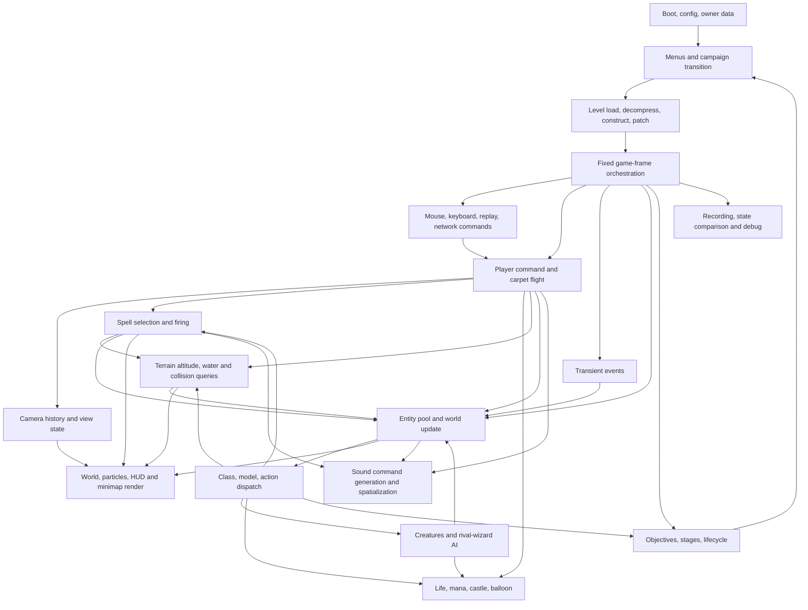
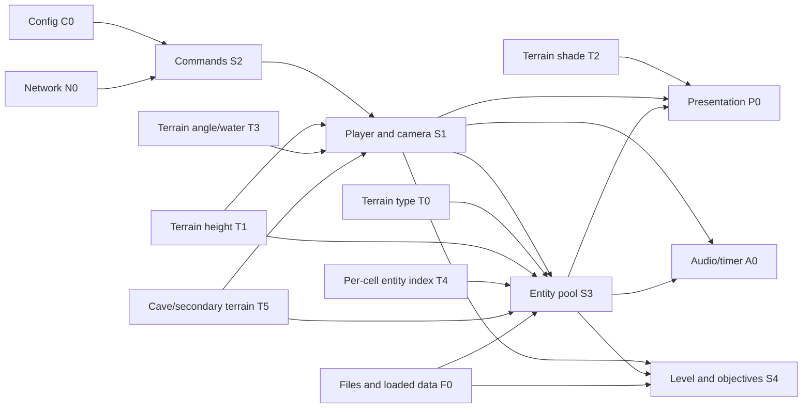
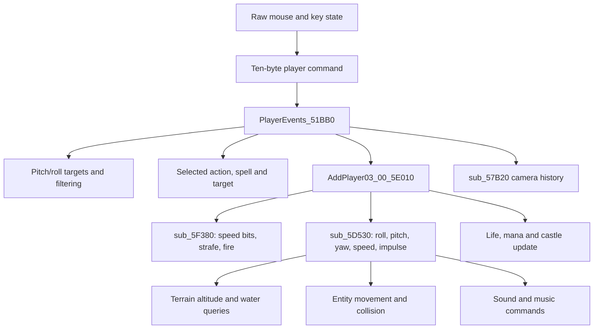

# remc2 gameplay-system map

Status: first excellent whole-program map  
Classification: `PRIVATE_ANALYSIS`  
Exact source state: see `generated/manifest.json`

This is the human map over the exact-build mechanical census. The full sparse
matrices remain in `generated/`; this document shows the shape we need for a
new flying-carpet engine without pretending that remc2 is already a reusable
library.

## What we are dealing with

The exact Debug build selects 74 translation units. The first census recovered:

- 3,060 functions;
- 1,370 globals/statics;
- 24,249 call/reference edges;
- 76,980 typed field/global access edges;
- 3,246 distinct typed state targets;
- 61,090 literal occurrences; and
- 684 recognized bulk-memory operations.

Only `stdafx.cpp`, a 640-byte UTF-16 precompiled-header stub, is not parseable
by libclang. All 73 substantive translation units parse without errors. Five
additional C/C++ files are present but not selected by this build and remain
listed rather than silently ignored.

The central fact is that remc2 is a reconstructed whole program, not a clean
simulation library. The useful engine is present, but distributed across a
large event/gameplay unit, global packed state, action tables, loaders, and
host/render/audio code.

## Authoritative flow



The canonical static frame order is in
`DrawAndEventsInGame_47560` (`EventsFunctions.cpp:31732-31885`):

1. counters, palette and animation;
2. input capture and translation;
3. debug/load/save hooks;
4. player events;
5. transient events;
6. one, four, or eight entity/world updates according to speed mode;
7. lighting;
8. objectives and lifecycle;
9. entity sound generation;
10. world/HUD rendering;
11. regression comparison; and
12. final help, blend, blit and counters.

This order is part of the feel. A new engine should make it explicit and
testable instead of allowing Unity/browser callback order to define gameplay.

## System census

The filename and source-range classifier is a navigation aid, not semantic
proof. Its first whole-program partition is:

| Domain | Functions | State edges | Interpretation |
|---|---:|---:|---|
| Entity AI and general gameplay | 1,223 | 26,109 | The large recovered core and our main archaeology surface |
| Player flight and actions | 50 | 4,324 | Input filtering, movement, terrain response, spells and feedback |
| Terrain and world mutation | 45 | 2,576 | Five 256x256 grids plus generation/query/mutation |
| Spells and projectiles | 35 | 894 | Loaded tables, casting, projectile/effect entities |
| Mana, castle and economy | 19 | 769 | Player progression and strategic loop |
| Objectives and progression | 4 | 643 | Dense global-state evaluator functions |
| Entity pool and dispatch | 21 | 987 | Fixed pool, spatial index, action/state-machine bridge |
| Frame and level scheduler | 7 | 615 | Candidate deterministic step boundary |
| Camera | 1 | 70 | Camera-history construction; consumption is in rendering |
| Level data and persistence | 130 | 1,512 | Load, decompress, initialize, save and pointer repair |
| World and HUD rendering | 119 | 18,749 | Several renderer variants; not the new simulation core |
| Menus, HUD and frontend | 150 | 7,545 | Campaign presentation and original UI |
| Audio and music | 325 | 3,172 | Game audio plus substantial MIDI/host support |
| Network | 119 | 1,376 | Original transport/input relay plus platform code |
| Replay and regression | 35 | 1,006 | Deterministic input and native/oracle comparison support |
| Remaining host/config/types/utilities | 827 | 5,693 | Compatibility, recovered types, tables and support code |

## State-region model



The raw state-access matrix does not force every recovered field into one of
these regions. Unknown/shared state remains `U0` until classification earns a
more specific label.

## Flight chain already visible



Representative source anchors:

- raw normalization: `PlayerInput.cpp:2100-2141`;
- command handling: `EventsFunctions.cpp:37536-38093`;
- fixed-table displacement: `Player.cpp:6-19`;
- flight integration: `EventsFunctions.cpp:59658-59780`;
- player action/economy update: `EventsFunctions.cpp:60003-60090`;
- speed/strafe/fire decode: `EventsFunctions.cpp:60795-60912`; and
- camera history: `EventsFunctions.cpp:40197-40283`.

This is a tractable extraction surface. The apparent 4,324 state edges include
UI, replay, network, debug, sound and broad shared state; the actual carpet
integrator is much smaller.

## Heightfield to voxel seam

We should preserve the command model, fixed-step order, flight response,
events and strategic rules while replacing direct height-array knowledge with
an authored world contract:

```text
CarpetCommand
  -> CarpetFlightStep
       -> WorldQuery.altitude_or_surface(...)
       -> WorldQuery.water_or_material(...)
       -> WorldQuery.sweep_or_contact(...)
       -> WorldMutation.apply_spell_effect(...)
  -> Player/Carpet state
  -> Simulation events
```

The first adapter can reproduce the original heightfield behavior. The second
can query a voxel world with caves, overhangs, destructible volumes and cities.
Both run against the same carpet-flight and gameplay tests. This lets us try
“MC2 in voxels” without confusing a renderer swap with a simulation rewrite.

## How to navigate the complete map

The generated outputs are deliberately sparse rather than one unreadable
million-cell table:

- `function-matrix.csv` — all recovered functions, subsystem seed, source,
  call degree, state-edge counts, literals and bulk operations;
- `call-edges.csv` — every recovered direct, unresolved/indirect, and
  address/callback reference edge;
- `state-access-edges.csv` — every typed function-to-field/global access with
  access kind, confidence and source location;
- `state-targets.csv` — all distinct state targets ranked by fan-in;
- `subsystem-call-matrix.csv` — compressed whole-program call graph;
- `subsystem-state-matrix.csv` — compressed domain-to-state-region graph;
- `subsystem-call-graph.svg` — intentionally complete, and therefore useful
  mainly as a coupling overview; and
- `atlas-overview.md` — census, largest domains and connectivity hubs.

The next pass is not “map everything again.” It is:

1. classify the flight/player/terrain rows;
2. trace loaded gameplay table lineage;
3. turn the flight chain into explicit equations and ordered pseudocode;
4. define the heightfield/voxel world-query seam; and
5. validate only consequential ambiguities with deterministic recordings.

